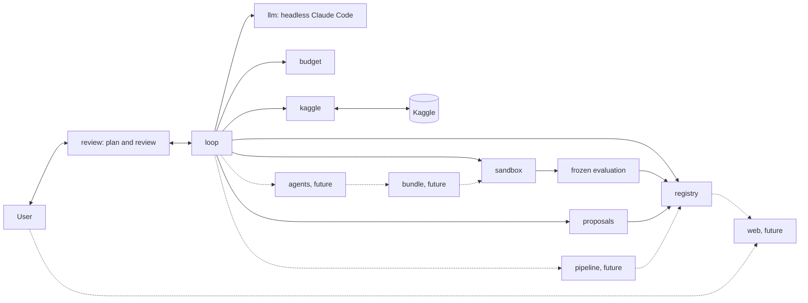

# Design of the data science agent for tabular Kaggle

This document is the design on which all later tickets are based. It does not implement the agent. For each choice it lists the alternatives considered and why they were rejected.

## 1. Goals and non-goals

**Goals**

- An agent that does the iterative work of a data scientist on a tabular Kaggle competition, from downloading the data to the submission.
- A team of five role agents does the work of a data science lab: coordinator, data, feature engineering, modeling and reviewer. The design has three levels with the same core structure, the same five roles and the same guarantees (frozen protocol, labels and holdout owned by the evaluator, everything in the registry, tests with fakes); the levels differ only in the machinery around the roles (table in section 14). Level 1 is built first; level 2 and level 3 are directions, not commitments.
- The lead (the human) approves a short initial plan; then the agent works autonomously in rounds, each with several candidates, and the lead steps in after every round (guidance, or let the cycle continue) and at the end of the cycle, by reviewing the report. Every candidate is tracked and can be consulted from a read-only web interface.
- Fully automatic interaction with Kaggle: download, reading of rules and metric, sending of submissions, reading of the score.
- Runs on a Mac without GPU, with small or medium tabular datasets.
- No paid API: the model that reasons at runtime is headless Claude Code with the subscription.
- Metrics, validation schemes and techniques are not fixed in the design. The agent derives them from the problem (rules, nature of the data, type of target) and justifies them. The design defines how it chooses them, how it justifies them and how it avoids fooling itself.
- The design does not prevent the future predict + optimize vision (section 14).

**Non-goals**

- This ticket does not write modeling logic: it produces the document and an empty skeleton of the repo.
- No validation of the individual steps by the lead: the control points are the initial plan, the guidance after each round and the final review (section 2). Guidance never changes the frozen protocol.
- No polished graphic design of the interface: it is deferred to a later ticket.
- No support for GPU, deep learning on images or text, code competitions (notebook-only) or datasets that do not fit in memory on a Mac.
- No parallel candidates, login, Docker or other data sources at level 1 (section 14).
- No optimization for leaderboard rank at any cost: the agent must not sacrifice the validity of the evaluation to climb the leaderboard.

**Principle on the stack**

Python 3.12, pandas, scikit-learn, LightGBM and local MLflow are a **starting point, not a constraint**. The design does not fix them. Each development ticket chooses the libraries it needs, evaluating the alternatives at that time and documenting the choice. The selection criteria are:

1. works on a Mac without GPU;
2. no paid API or service;
3. tests run without network (the library must be able to be simulated or used offline);
4. low maintenance cost: widespread library, stable API, few transitive dependencies;
5. reproducibility: pinned versions and deterministic behavior for the same seed.

Rejected alternative: fixing the complete stack now in the design. Rejected because we do not yet know what will really be needed (for example whether pandas is enough or a faster alternative is worth it) and because a choice made with no code to write would be without evidence. For the same reason the first tickets declared no runtime dependencies; each library enters `pyproject.toml` with a pinned version in the ticket that needs it. So far the evaluation ticket confirmed pandas, numpy and scikit-learn (section 5) and the Kaggle ticket the official `kaggle` package (section 10).

## 2. Work cycle

The cycle is a state machine, implemented as fixed code in the `loop` subpackage. The state is persisted after every transition, so a crash does not lose work. The lead approves a short initial plan; then the agent works autonomously in rounds. After every round the cycle waits for the lead, who gives guidance or lets the cycle continue. The individual steps are not validated by the lead.

States:

| State | Meaning | Who acts |
|---|---|---|
| `PLANNING` | the coordinator analyzes problem and data and writes the short initial plan (section 4) | model |
| `AWAITING_PLAN_APPROVAL` | the plan is presented to the lead, who approves or corrects it; it is the single point of control before the cycle | lead |
| `SPLITTING` | the code creates the validation set, which drives the rounds, and the test holdout, never used to decide (section 5) | code |
| `BASELINE` | first model trained and evaluated on the validation set | code and model |
| `ITERATING` | one round: several candidates, each one an attempt, with the sub-steps `propose`, `validate`, `execute`, `analyze`, `record` (the reviewer then writes its report on the round) | model and code |
| `AWAITING_GUIDANCE` | after each round the lead gives guidance, recorded as a suggestion, or lets the cycle continue | lead |
| `REPORTING` | short final report and evaluation of the test holdout on the best attempt | code and model |
| `AWAITING_REVIEW` | the lead accepts or gives suggestions | lead |
| `STOPPED` | a stop criterion fired or the cycle ended (section 11) | code |

Happy path: `PLANNING → AWAITING_PLAN_APPROVAL → SPLITTING → BASELINE → ITERATING (a round) → AWAITING_GUIDANCE → ITERATING → ... → REPORTING → AWAITING_REVIEW`. After the plan is approved the only waits are the guidance after each round and the final review.

**Configurable parameters.** The number of rounds N (provisional default 5; the previous cycle without rounds had N = 10 by default iterations), the number C of candidates per round (provisional default 3), the number K: K rounds without real improvement stop the cycle early (section 11), the number M of rounds in a row without a pause for guidance (default 1; M = N is the previous cycle without pauses) and the cap on fix retries per attempt (3 by default). The defaults are provisional and will be tuned after the first real run.

**Terminology.** A candidate is an attempt (section 4). Where the older sections say iteration they mean a round or a candidate, as the context shows.

**One round.** The coordinator reads a compact summary of the registry and sets the direction of the round (section 8). For each of the C candidates the model analyzes the metric and the errors (section 9), formulates a hypothesis, decides what to change (feature engineering, model, hyperparameters, data cleaning, etc.) and runs a new attempt. The code checks the shape of the attempt and duplicates, runs it in the sandbox with the frozen evaluation and records the outcome. Every candidate produces an attempt in the registry (section 7). At the end of the round the reviewer interprets the results and writes a report; the report never decides (section 8).

**Guidance.** At `AWAITING_GUIDANCE` the lead can give guidance on what to explore, which is recorded as a suggestion and read by the coordinator in the next round, or let the cycle continue. With M greater than 1 the cycle runs M rounds in a row before the next pause. A protocol change is not guidance: it needs a new plan approval (section 5).

**Review at the end of the cycle.** The lead accepts, or gives suggestions on what to explore. The suggestions are recorded and start a new cycle, which restarts from the existing state (best model and history of attempts) and skips the plan approval phase, except for a change of the protocol (section 5).

Unhappy cases:

- **Invalid or duplicate attempt proposal** (`validate`): back to `propose` with the reason for the rejection passed to the model. After a maximum number of consecutive rejections the candidate is recorded as `inconclusive` and the round goes on.
- **Execution error** (exception, memory, invalid code): code fixes are not attempts and do not consume one of the N iterations, because an attempt is one ML idea (features, model, hyperparameters, data cleaning). The agent fixes the code and reruns inside the same attempt, without approval, with a cap of 3 fix retries per attempt (configurable). Every run is recorded with its traceback. If the cap is exceeded the attempt is closed with outcome `failed` and `failure_kind = code_error`, and the agent goes on. A cap on consecutive attempts closed as failed stops the cycle: once it is exceeded the cycle moves to `REPORTING`.
- **Execution timeout**: the process is terminated, the attempt is `failed(timeout)`; the next attempt must estimate a lower cost or reduce the data.
- **Approval timeout**: applies to the plan, the guidance after a round and the final review. The state stays waiting; there is no implicit approval. The cycle is suspended and can resume from the saved state.
- **Model error** (rate limit, malformed response): retry with backoff; if it persists, the cycle is suspended without losing the state and resumes from the saved state.

Rejected alternatives:

- *Human validation of every single step*: rejected because the requirement is that the lead steps in only at the plan, after each round and at the end; protection lies in the frozen evaluation, the sandbox and the recording of everything.
- *Separate approval of metric and validation*: rejected because the short plan already contains them and a single point of control is lighter for the user.
- *Guidance after every single candidate*: rejected because it turns the lead into a bottleneck; the round is the unit of control.
- *No control point*: rejected because a wrong metric or validation scheme invalidates the whole cycle; the approved plan is the minimum control.
- *Cycle without a cap on rounds*: rejected because it consumes the subscription quota and favors overfitting on the validation set.
- *A generic agent framework with a dynamic graph*: rejected because it hides the transitions and makes it hard to guarantee that the evaluation is not bypassed; an explicit state machine is testable with fakes.
- *Unlimited automatic correction of errors*: rejected because the model could get around an evaluation error by changing the protocol instead of its code; hence the cap of fix retries per attempt and the cap on consecutive attempts closed as failed.
- *Every code fix recorded as a new attempt*: rejected because fixes would consume the N rounds and a crash is not a new idea; the fixes stay as execution records of the same attempt, so they remain traceable.

## 3. Work phases

The phases are not a rigid list: they form a graph. The agent can go back to any earlier phase when the evidence justifies it (e.g. the error analysis discovers a data quality problem). The return is decided by the agent without approval and recorded in the attempt with its rationale. The evaluation protocol is the exception: it is frozen (section 5).

Each phase has an owner among the five roles (section 8) or the fixed code. The roles are the coordinator, the data role, the feature engineering role, the modeling role and the reviewer; the runner is fixed code.

| Phase | Who runs it | Input | Output | What the agent decides |
|---|---|---|---|---|
| Acquisition | fixed code | competition identifier, credentials | raw data, data hash, rules, description of the metric | which files to download; nothing more, the rest is fixed code |
| Problem understanding | coordinator | rules, description, raw data | summary of the problem: type of target, official metric, constraints (submission limits, external data) | interpretations of the rules, reported in the plan |
| Data exploration | data | raw data | profile: types, missing values, distributions, duplicates, hints of leakage, difference between train and test | targeted analyses and charts to produce |
| Initial plan | coordinator | understood problem, data profile | short plan with metric and why, validation, feature engineering, models, baseline (section 4); with the approval the protocol is frozen | the complete plan, approved or corrected by the lead |
| Split | fixed code (evaluator) | approved plan | validation set for the rounds and untouched test holdout | nothing: it is fixed code |
| Baseline | modeling, run by the runner | data, frozen protocol | first model trained and evaluated, with its uncertainty | the simple baseline indicated in the plan |
| Round | coordinator sets the direction; data, feature engineering and modeling write the candidates | previous outcomes, reviewer report, guidance | candidates, each an attempt with hypothesis, change and metrics | what to change: features, model, hyperparameters, data cleaning, without approval |
| Execution and metrics | runner (fixed code) | the bundle of a candidate | out-of-sample predictions and metrics computed by the runner | nothing: it is fixed code |
| Error analysis | reviewer reads the tables computed by the code | out-of-sample predictions | weak segments, hypotheses (section 9) | new hypotheses for the earlier phases |
| Combination | modeling | candidate models | ensemble or selection | only if the models have different errors, with evidence |
| Report and pipeline | coordinator and reviewer | history of attempts, best attempt | short final report, test holdout, end-to-end pipeline (section 13), generated submission | which attempts to tell and which variants to propose |

The actual submission to Kaggle is not a phase of the autonomous cycle: it is an explicit action of the user after the review (section 10).

Rejected alternative: fixed linear pipeline (explore → features → model → submission). Rejected because real work goes back often and a rigid sequence forces useless steps or hides the return.

## 4. Proposal format

**Short initial plan.** After analyzing problem and data the agent writes a plan of at most one page, readable in 2 minutes. It is the only document the user approves or corrects before the cycle (section 2). It has five mandatory items:

1. metric and why;
2. validation scheme;
3. planned feature engineering;
4. models to try;
5. baseline.

The code (`proposals` subpackage) rejects incomplete or overlong plans; the length limit is `MAX_PLAN_WORDS` (300 words, a word count used as a proxy for the page). Example (abridged):

```yaml
metric: "official competition metric; it is the one that decides the leaderboard"
validation: "partitions that mimic the separation between train and test (evidence: comparison of the distributions)"
feature_engineering: ["missing-value indicators", "encoding of rare categories"]
models: ["boosted trees", "regularized linear model"]
baseline: "simple model with default parameters"
```

**Attempt.** After the plan every iteration is an attempt, that is a falsifiable hypothesis of the agent. It is not submitted to the user: the schema is validated by the code and the attempt is recorded. Fields:

- `id`, `phase`, `parent_id` (the attempt it descends from);
- `hypothesis`: a precise statement ("adding X improves Y because Z");
- `rationale` with `evidence`: in natural language, because it is shown in the web interface (section 13); references to attempts, charts or analyses that support it; a hypothesis without evidence must be marked `exploratory`;
- `what_changed`: what changes with respect to the `parent_id` attempt;
- `expected_effect`: direction and order of magnitude of the change of the frozen metric;
- `measure`: how it will be checked, in the frozen protocol, and which outcome falsifies the hypothesis;
- `estimated_cost`: compute time, subscription quota;
- `risks`: leakage, overfitting of the validation, instability, cost;
- `artifacts`: code (diff), configuration files, linked pipeline.

Example of an attempt (abridged):

```yaml
id: T-0014
phase: iteration
parent_id: T-0009
hypothesis: "Errors are concentrated in records with a missing value in 'column_a'; a missing-value indicator reduces the error in that segment."
rationale: "In attempt T-0009 the error is much higher where 'column_a' is missing."
evidence: ["T-0009/error_by_segment", "profile/missing_pattern"]
what_changed: "added a missing-value indicator feature; model and hyperparameters unchanged"
measure: "frozen metric on the validation set and on the segment; falsified if the improvement is below the significance threshold of the protocol"
```

Rejected alternatives: free text (not verifiable by the code, not deduplicable), code only without a hypothesis (the registry cannot remember what was meant to be learned) and a long, detailed plan (it cannot be read in 2 minutes and the user stops reviewing it).

## 5. Choice of the metric and the evaluation protocol

The design does not fix the metric, the validation scheme or the techniques. It describes the process by which the agent derives and justifies them.

**Derivation.** In the initial plan phase the agent derives the metric and the validation scheme from three sources, each cited as evidence:

1. *Rules and competition page*: the official evaluation metric, the submission format, any constraints. The official metric is the default; if the agent chooses a different development metric it must explain why (e.g. more stable) and how it relates to the official one.
2. *Nature of the data*: temporal dependence, groups or repeated entities, distribution of the target, size. From these the validation scheme is derived: it must mimic the way the test is separated from the train (chronological, by group, random). The agent cites the evidence (e.g. comparison between the train and test distributions, overlap of identifiers).
3. *Type of target*: type of problem, imbalance, heavy tails, which influence the stratification and the reading of the metric.

**Justification in the plan.** The justification of metric and validation is contained in the initial plan (section 4), which replaces the separate approval of metric and validation. The plan says which metric and scheme are chosen and why, the alternatives considered, the threshold with which an improvement is considered real (section 6) and the share of data kept as test holdout. The estimate of the protocol noise (variance across seeds and across partitions) is computed by the code on the baseline and recorded. The correlation between validation score and public score is a consistency check done after the review, if the user sends a submission.

**Split.** After the approval the code separates the data into a validation set, which drives the iterations, and a test holdout, which is never used to decide and is evaluated only at the end of the cycle (section 6). This avoids overfitting on the validation set.

**Protocol.** The plan stays human-readable text. Next to it the agent proposes a `Protocol` (in `evaluation`), a separate immutable record with the metric name and parameters, the direction, the target column, the partition scheme and its parameters for the validation folds and for the holdout, the holdout share, the seed, the number of repetitions and the factor `k` of the significance threshold (section 6). Every field is mandatory: there is no default metric, direction or scheme, and a protocol that leaves one out is rejected. Metrics and partition schemes are identified by name in two extensible registries in the fixed code of `evaluation` (the model cannot pass its own function). The building blocks are random partitions with optional stratification, partitions by group and chronological partitions; they are tools, not choices. Each metric declares its natural direction; the protocol states the direction explicitly and the code only checks that the two agree (a custom metric with a non-conventional direction is registered as a separate metric). The protocol must yield at least two validation partitions (repetitions times folds), otherwise the dispersion of the baseline is undefined.

**Repetitions.** Every repetition has its own partitions when the scheme is random or by group. A deterministic scheme (the chronological one) gives the same folds in every repetition and only the seed passed to the candidate changes; the dispersion of the baseline then measures the noise of the model seed. The seeds of the repetitions are derived from the seed of the protocol.

**Freezing.** With the approval of the plan the code computes a hash of the protocol (definition of the metric, partition scheme with seed, threshold, holdout) together with the evaluation code, and saves it on the cycle in the registry. The evaluation code is covered by the SHA-256 of the source files of the `evaluation` package, computed at runtime, so nobody has to bump a version constant; the flip side is that any edit of the package, even a reformat, invalidates the frozen protocols of open cycles. The versions of the libraries are not part of the hash (they are pinned and do not change inside a cycle); they are recorded in the resources of every execution. Every attempt recomputes the hash and compares it with the one stored on the cycle before starting, and before every holdout read; a different hash blocks the run, and a cycle without a frozen hash cannot be evaluated. The protocol stays frozen for the whole cycle: a change during the cycle is not allowed. If the evidence shows that it is inadequate, the agent says so in the final report with an explicit proposal, motivated by the evidence. If the user approved it in the review, it applies to the next cycle; the earlier results are marked as not comparable and the registry keeps both versions.

**Library decision (evaluation ticket).** Data enter the engine as pandas DataFrames, and pandas, numpy and scikit-learn are runtime dependencies pinned with `==`. They are judged on the criteria of section 1: they run on a Mac without GPU (1), are free (2), work offline and need no simulation in tests (3), are widespread with a stable API (4), and give deterministic results for the same seed (5). The package is the only code allowed to import them; `proposals` and `registry` stay on the standard library.

Rejected alternatives for this decision:

- *Pure Python for metrics and partitions*: rejected because reimplementing them is error-prone (ties, stratification, edge cases) and gives no benefit on the criteria.
- *polars or pyarrow instead of pandas*: rejected because they are further from the stack the generated code and Kaggle notebooks use, with no need shown by the data sizes in scope.
- *scipy alone*: rejected because it offers statistics but no ready-made partitioning and metric building blocks.
- *Adding LightGBM or MLflow now*: out of this ticket; the engine needs no model library (candidates are supplied by the caller) and MLflow was not adopted for the registry.

Rejected alternatives:

- *Metric and scheme decided a priori in the design (e.g. one choice valid for all competitions)*: rejected because it depends on the problem and violates the key principle.
- *Leaving the model free to change the metric during the cycle*: rejected because it allows searching for the metric that gives the best result, that is fooling itself.
- *Freezing forever without exceptions*: rejected because an error in the protocol (e.g. leakage discovered later) must be correctable; the way is the explicit proposal approved between one cycle and the next.
- *Separate approval of metric and validation before the plan*: rejected because the plan already contains them with their justification.

## 6. Real improvement, noise and overfitting

An increase in the score is not an improvement until it passes the following checks, all in the fixed code of `evaluation`.

- **Noise across seeds and partitions.** Every comparison reports the variation across repetitions (different seeds, different partitions). The baseline is measured several times to estimate its noise. The improvement is considered real only if it exceeds the significance threshold defined in the protocol (section 5). The engine implements one parametric form: in a paired comparison on the same partitions, the mean difference, oriented by the direction of the metric, must exceed `k` times the dispersion of the baseline, where the dispersion is the sample standard deviation across all its partitions (repetitions times folds). The agent proposes `k` for the problem with the plan, and it is frozen in the protocol; the engine has no default. With a deterministic scheme and several repetitions the folds are identical and only the seed of the candidate changes, so the dispersion of the baseline captures the noise of the model seed; if the candidate ignores the seed the dispersion is zero and any positive improvement passes, which is why the agent justifies the repetitions in the plan.
- **Paired comparisons.** Two candidates are compared on the same partitions, to reduce the variance of the difference.
- **Overfitting of the validation set.** Every attempt adapts the choice a little to the validation set. For this reason the registry counts how many comparisons have been made in the cycle (every comparison is stored with candidate, reference, difference, threshold and outcome). Raising the threshold with that count is not implemented yet: the count is recorded so the rule can be added later. The hyperparameter search happens inside the inner validation, not on the reference partition.
- **Untouched holdout.** The test holdout is not accessible to the model or to the generated code and is not used to decide. The cycle has one holdout session at the end of the cycle, in which the best attempt and the variants requested by the user (section 13) are evaluated together. Every read is logged in the registry before the data is returned, an attempt is read at most once per session, no read is possible after the session is closed and the session cannot be reopened in the same cycle. A failed evaluation still consumes the session, because its read is already logged. The reads do not influence the decisions. The guarantee of this design is one of interface and log: the split object exposes only development data and the holdout is reachable through a single accessor. Real isolation from generated code arrives with the sandbox (ticket 6); inside one Python process the accessor cannot prevent a determined reader. If the score on the holdout is much worse, the improvement is suspect and the report says so. With cycles repeated after the suggestions the risk of overfitting also on the holdout grows: the design records it as an open risk (section 16).
- **Early stop.** K consecutive iterations without real improvement, that is above the significance threshold, stop the cycle (section 11).
- **Overfitting of the public leaderboard.** The public score covers a part of the test, often small. It does not drive development decisions: it serves as a consistency check with the validation. The number of submissions is limited (section 10).
- **Leakage diagnosis.** A very large jump is treated as suspect and produces a verification attempt before it is accepted.

Rejected alternatives:

- *Choosing the candidate with the highest public leaderboard score*: rejected because with few submissions and a small test it selects noise.
- *A classical statistical test on a single run*: rejected because the partitions are not independent and the test would overestimate certainty; the empirical variation across repetitions is preferred.
- *No threshold, every increase is accepted*: rejected because it accumulates overfitting of the validation set.
- *Evaluating the holdout at every iteration*: rejected because it would turn it into a second validation set.
- *Raising the threshold with the number of comparisons right away*: postponed; the count is recorded so the rule can be added later.

## 7. Experiment registry

The registry (`registry` subpackage) is the memory of the agent and the source of data for the web interface (section 13). For each attempt it saves:

- `hypothesis` and `rationale` in natural language, with the `evidence` and the `exploratory` mark;
- originating attempt (`parent_id`) and what changes with respect to it (`what_changed`);
- complete configuration, seed, code hash, data hash, hash of the frozen protocol (the same hash is stored once on the cycle at approval);
- metrics per partition, mean and dispersion;
- duration and resources;
- outcome: `succeeded`, `failed`, `inconclusive`, with the free-text **reason** (traceback, hypothesis falsified, improvement below threshold) and a structured `failure_kind`;
- `artifacts`: code and diff, predictions, charts, pipeline reference (the linked pipeline, section 13);
- conclusion of the analysis: what was learned.

**Identifiers.** From level 1 every record can be placed in the project and the round it belongs to: `project_id` (the competition work as a whole), `round_id`, `candidate_id` (equal to the attempt id), `run_id` (one execution of a candidate, equal to the execution record) and `bundle_id` (the bundle that was run, section 8). The cycle identifier stays as described below; a round belongs to one cycle.

**Records of the roles.** Next to the attempts the registry stores, append-only: the *reviewer report* of each round (text, round id, time), the *lead guidance* given at `AWAITING_GUIDANCE` (text, round id, time; it is also recorded as a suggestion, see below) and the *role traces* (for each role call: role, round, candidate when there is one, typed input and output, outcome, link to the call record of the `llm_calls` table). Traces hold no credential and no raw model text beyond the typed output.

**Attempt and execution records.** The `Attempt` of section 4 is the proposal; what happened when it ran is an *execution record*, a separate type in `registry` linked to the attempt by its id. The configuration, seed, hashes, metrics, duration, resources, outcome, `failure_kind`, reason and artifacts belong to the execution record. One attempt has one or more execution records: the initial run plus any code-fix retries (section 2). The registry stores all of them, so fixes are traceable, and the outcome of the attempt is the outcome of its last execution. An attempt is final only when it is closed with its conclusion; an open attempt has no outcome and does not appear in outcome or failure queries.

**Failure kind.** `failure_kind` has the values `code_error`, `hypothesis_falsified`, `timeout` and `below_threshold`. It is required when the outcome is not `succeeded` and absent when it is `succeeded`. The free-text reason is kept as well. `code_error` has two meanings. On an execution record it only means that this run crashed. At attempt level, once the attempt is closed, it means that the code still failed after the cap of fix retries, and the registry refuses to close an attempt as `code_error` before the cap is reached. The registry can list failures by `failure_kind`, so the agent avoids retrying falsified hypotheses and the web interface can filter them.

Known open point: an iteration recorded as `inconclusive` after repeated rejected proposals (section 2) has no execution and no fitting `failure_kind`, so it cannot be represented by an execution record. It is settled in the loop ticket.

**Evaluation records.** For the evaluation engine (section 6) the registry also stores, per cycle: the frozen protocol hash; the holdout session (opened and closed times; at most one per cycle, never reopened); the log of holdout reads (attempt, number of rows, time), accepted only while the session is open; and the paired comparisons with their count. These are append-only and the rules about who may read or compare are applied by the engine, not by the registry. SQLite files created before this change are migrated by adding the hash column.

**Submission records.** The registry also stores, per cycle, the submissions sent to Kaggle (`SubmissionEntry`, section 10): competition, submission id, SHA-256 of the file, message, time, status and, once the scoring ends, the public score and completion time. The entry is append-only except for one update of status and score, accepted once; it holds no credential. Existing SQLite files gain the new table when opened.

**LLM call records.** For the subscription budget (section 11) the registry stores, per cycle, the consumption of every call to the language model (`LlmCallEntry`, section 8): purpose, outcome (`ok`, `rate_limited`, `quota`, `cli_error`, `invalid_output`), start time, duration, input and output tokens when reported, attempt number, the model used (none when unknown) and `rejection_reason` (the sanitized validation reason of an `invalid_output` call, none otherwise; a nullable column that existing files gain when opened). It is append-only, holds no prompt, no response and no access token, and existing files gain the `llm_calls` table when opened.

**Cycle and suggestions.** A cycle has an identifier, approved plan, parameters (N, C, K, M, cap of fix retries), state and, once approved, the frozen protocol hash. A user suggestion has text, origin cycle and the cycles spawned from it. A new cycle restarts from the best model and the history, and the suggestion stays recorded together with the cycles it generated.

**Required queries.** The registry must support the queries of the web interface: list of attempts, series of the metric per iteration, detail of an attempt, suggestions and linked cycles. For the rounds it also supports: the rounds of a project with their candidates, the reviewer reports of a round, the role traces of a round or a candidate, the lead guidance, and the series of the metric per round (best and spread of the candidates of each round).

**Deduplication.** Two levels: (1) a deterministic *fingerprint* (hash of normalized configuration, code, data and protocol) discards exact duplicates; the code hash is included because features and models live in the code, so the same configuration with different feature code is a different idea. The check runs when a new attempt is proposed, against all previous attempts whatever their outcome; the fix retries of the same attempt are not checked against each other; (2) a semantic check: before proposing, the model receives a summary of the related attempts and must declare how the new attempt differs. The code rejects attempts without this declaration.

**Memory of failures.** Failures enter the context of `propose` as a compact list "what was tried, outcome, why"; an attempt that failed because of a code error is distinguished from one that failed because the hypothesis was wrong, through `failure_kind`.

**Replaceable interface.** The registry sits behind an interface (`Registry`), so the storage can be replaced.

Alternatives considered:

- *Local MLflow*: good interface and comparison of runs, but a heavy dependency and less suited to saving hypotheses, cycles and suggestions.
- *Own registry (SQLite or JSONL)*: simple, inspectable, no dependencies, but the visualization part must be written.
- *Both*: the own one as the source of truth and MLflow as an optional view.

**Decision (registry ticket).** SQLite through the standard library `sqlite3` is the source of truth behind the interface. It needs no dependency and no network, it is cheap to maintain (stable API, nothing to pin) and it is reproducible and inspectable; UNIQUE constraints and transactions enforce deduplication and referential integrity. Rejected: local MLflow, because of its many transitive dependencies and poor fit for cycles, suggestions and hypotheses (it stays possible as an optional view behind the same interface, outside this ticket); JSONL, because it has no transactions or unique indexes; and using both now, because there is no need yet for the second one. Rejected for now: memory entrusted only to the model context, because it is lost between sessions and is not verifiable.

## 8. Roles: model and deterministic code

**The five role agents.** Five roles are present from level 1: the *coordinator* (reads the problem, writes the plan, sets the direction of each round, reads the lead guidance and writes the final report), the *data* role (profiles the data, finds quality problems and leakage hints, proposes cleaning), the *feature engineering* role (proposes the transformations), the *modeling* role (proposes models and hyperparameters) and the *reviewer* (interprets the results of a round and reports). The roles decide and write: hypotheses, rationales, the code of the candidates, the interpretation of the results and the initial plan. They are creative but not reliable.

**The reviewer is never a gate.** The reviewer interprets and reports; it does not accept or reject a candidate, and nothing in the cycle waits for its judgment. The significance threshold, the comparisons between candidates, the stop criteria and the choice of the best attempt stay in fixed code.

**The fixed code (not modifiable by the model):** cycle and state machine, split, the runner and the computation of the metric, significance threshold, holdout, access to Kaggle and credentials, budget, registry, hashes. The evaluator owns the labels and the holdout: no role ever receives them.

**The lead (the human):** approves or corrects the initial plan, gives guidance after a round or lets the cycle continue, and reviews the final report (accepts or gives suggestions). Does not validate the individual steps.

**Orchestration at level 1.** A role is a prompt with a typed input and a typed output, called on `LlmClient`; there is no framework and no tool use beyond what the adapter allows. A plain sequential pipeline runs them in a fixed order: coordinator, data, feature engineering, modeling, runner, reviewer, coordinator. The roles do not call each other: each one receives its input from the pipeline and returns its output to it. The coordinator reads a compact registry summary inside its prompt (best attempts, recent failures, reviewer reports, lead guidance), so no role needs a database tool. Every call leaves a role trace in the registry (section 7).

**Bundle contract.** A candidate is a bundle: a folder with the code, the transformations, the model, the declared dependencies, and two entry points, `fit(train)` and `predict(bundle_id, X)`. The runner, which is fixed code, runs the bundle in a subprocess with a timeout, passes the data without labels, calls `predict` on the partitions and computes the metrics itself. The bundle never sees labels it should not see and never reports its own score. The levels differ in the isolation: at level 1 the bundle is a plain folder run in the same Python environment as the agent; at level 2 bundles are immutable versions with a hash and each variant has its own virtual environment; at level 3 each bundle runs in a container.

**How the model is prevented from altering the evaluation:**

1. the generated code runs in a sandbox (`sandbox` subpackage) that receives only the training data and a narrow interface: the bundle contract above; the partition and the metric are executed outside the sandbox;
2. the evaluation files are read-only or outside the writable tree; the model has no permissions on the paths of the fixed code;
3. before every attempt the code checks the hash of the evaluation files and of the protocol; a difference blocks the run;
4. the test holdout data and the test labels do not exist in the sandbox; the holdout is read only by the fixed code at the end of the cycle and every read is logged;
5. the headless Claude Code process has tool permissions limited to the workspace of the run; changes outside it are rejected and logged;
6. with no human rereading the diffs, the code automatically rejects code that touches protected files and records the diff in the attempt, so every change can be reconstructed afterwards.

**Light sandbox (level 1, built).** `SubprocessSandbox` runs a command or a Python entry point in a child process of its own process group, with a mandatory timeout (on expiry the whole group is killed), a fresh working directory, captured output with a size limit and a minimal environment built from scratch: fixed `PATH`, `HOME` and `TMPDIR` inside the run folder, no credentials, no `PYTHONPATH`; the child is started with `python -I`, so import paths must be passed explicitly. The protected files (evaluation package, frozen protocol, runner, holdout) are hashed with SHA-256 before and after the run, on the originals and on the read-only copies the child sees; a diff that touches them is rejected before anything starts, and a changed hash blocks the run, even when the child exits with 0. The holdout is hashed but never copied. Failures use the existing failure kinds: `timed_out` is `timeout`; `crashed`, `protected_modified` and `diff_rejected` are `code_error`, with the precise cause in the result `status`. Callers must check `status`: `protected_modified` and `diff_rejected` are integrity failures and are never retried as code fixes; only `crashed` is a candidate for fix retries.

**Headless Claude adapter (`llm` subpackage).** The model is reached through the Claude Code CLI run non-interactively with the user's subscription, behind an interface (`LlmClient`) that the tests replace with a deterministic fake (`FakeLlmClient`). Facts checked against the CLI before the design, with **version 2.1.296** on 2026-10-23 (`claude --version`, `claude --help` and one real call). The CLI was not logged in on that machine, so only the following was observed; the rest is marked *not verified*.

- *Verified*: `-p/--print` runs non-interactively and reads the prompt from stdin; `--output-format json` prints one JSON envelope (`text` and `stream-json` also exist); `--model <model>` takes an alias or a full model name, and without it the CLI uses its own default; `--tools` selects the built-in tools (`""` disables all of them), `--allowedTools` and `--disallowedTools` take tool names, `--permission-mode` accepts `dontAsk` among its choices; `--no-session-persistence` disables sessions; `--resume <session id>` and `--session-id` exist; `--json-schema` exists; `--bare` makes authentication strictly API-key based, so it is never used. The envelope seen has `type`, `subtype`, `is_error`, `result` (text), `session_id`, `duration_ms`, `duration_api_ms`, `total_cost_usd`, `usage` (`input_tokens`, `output_tokens`, cache token counts), `modelUsage`, `terminal_reason` and `api_error_status`. A failed call (not logged in) had exit code 1, `is_error` true and the message in `result`.
- *Not verified* (needs the manual smoke test of the README): the envelope of a successful call and what `modelUsage` holds, hence whether the used model is reported; how a rate limit and an exhausted quota are reported (text, `api_error_status`, reset time); other exit codes; the effect of `CLAUDE_CODE_OAUTH_TOKEN`; the exact behavior of `dontAsk`; session resume in practice (documented, not used). The adapter classifies by text and `api_error_status` (429, 529) and reads a reset time written as `|<epoch seconds>`; these formats are assumptions that the canned test envelopes reproduce, and any failure it cannot classify becomes a sanitized `CliFailureError`.
- *Subscription only*: the process never receives `ANTHROPIC_API_KEY` or the other variables that move billing to a paid API or a cloud provider (`ANTHROPIC_AUTH_TOKEN`, `CLAUDE_CODE_USE_BEDROCK`, `CLAUDE_CODE_USE_VERTEX`, `CLAUDE_CODE_USE_FOUNDRY`). The adapter strips them from a copy of the environment (`os.environ` is never modified) instead of refusing to start, and logs a WARNING that names the variable and never its value; the removed names are exposed in the result, the call record and the raw response. The rest of the environment is passed on so the CLI keeps working. Authentication is the user's setup (for example `CLAUDE_CODE_OAUTH_TOKEN`); the token is only in the environment of the CLI process and is never logged, put in an error message, stored in the registry or passed to the sandbox. Error messages never contain raw stdout or stderr.
- *Minimal tool permissions*: the tools come only from a `ToolPermissions` value given by the caller (none by default) together with the working directory, which must be absolute and existing; the adapter passes them to `--tools` and `--allowedTools` with `--permission-mode dontAsk` and never uses a permission bypass. `ToolPermissions` is the only interface the sandbox will need. Isolation rests on these flags and the working directory until the sandbox exists.
- *Structured output*: `ask` appends an instruction to answer with one JSON object, extracts it (bare, in a code fence or inside prose) and validates it with the existing types (`ShortPlan`, `Attempt`, ...). An invalid answer is retried a bounded number of times, sending the original prompt plus the validation error (stateless, so independent of session resume), then `InvalidResponseError` is raised; the caller sees only `LlmError` subclasses.
- *Rate limit and quota*: a rate limit is retried with a bounded exponential backoff (`BackoffPolicy`, honoring a retry-after capped at the maximum delay) using an injected sleep; an exhausted quota is raised at once as `QuotaExhaustedError`, with the reset time when known. Defaults are provisional: the final values belong to the budget ticket.
- *Model selection*: the client and each call take an optional `model`; `None` means the default of the CLI, no model name is written in the code and the choice per phase belongs to the loop. The effective model of each call (the one the CLI reports, else the one requested, else none) is recorded.
- *Consumption*: every CLI invocation, successful or not, produces a call record (purpose, outcome, duration, tokens when reported, attempt number, model), available from the client, in the result and through an `on_call` callback; `llm/recording.py`, the only `llm` module that imports the registry, stores it in the `llm_calls` table (section 7). The adapter reports consumption and enforces no budget.

- *Rich contract*: `json_contract` states for every field the JSON type derived from the annotations (unmapped annotations fall back to "any JSON value") and whether it is required, plus the constraints returned by the optional `contract_hints()` of the output type, kept next to the types in `proposals` (for `ShortPlan` the non-empty lists and the limit of `MAX_PLAN_WORDS` words; for `Attempt` the non-empty fields and the evidence/exploratory rule). `llm` knows no concrete type. It reduces first-try rejections, which in the first real run cost about 7k input tokens each.
- *Rejection reason*: a rejected answer records a sanitized `rejection_reason` (field and reason of the `ValidationError`, at most 200 characters, never the model's text; a field that is not a field of the type, the type name or an object label becomes `response`) in the call record and in `llm_calls`.
- *Manual smoke test* (macOS, subscription, `claude-sonnet-4-6`; CLI version not recorded): the key was stripped with a WARNING naming only the variable, the success envelope was read (usage reported) and a valid `ShortPlan` came back, so the envelope of a successful call is now verified. Still *not verified*: rate limit and quota reporting and the effect of the OAuth token.

Rejected alternatives:

- *Trusting instructions in the prompt ("do not modify the evaluation")*: rejected because it is not a control, only a request.
- *Letting the model also write the evaluation and reviewing it by hand*: rejected because every change must be reread, it does not scale and a subtle error goes unseen.
- *Isolation with a container for each run*: postponed; costly on a Mac. The sandbox starts as a separate process with reduced permissions and can evolve.
- *Reviewer as gate*: rejected because a model that accepts or rejects candidates makes the stop and comparison rules depend on a non-deterministic judgment, and the evaluation could be argued around; the reviewer only reports.
- *A single agent for all roles*: rejected because one long prompt mixes data, features, models and judgment, cannot be tested one role at a time with fakes, and leaves no per-role trace.
- *A container per variant at level 1*: rejected because it is costly on a Mac and the first level needs to prove the loop first; containers arrive at level 3, with immutable versions and virtual environments at level 2.
- *Roles that call each other*: rejected at level 1 because the order and the cost of the calls become unpredictable; the plain pipeline is testable with fakes.

## 9. Error analysis

After every significant attempt the code produces, from the out-of-sample predictions:

- distribution of the residuals and relation with the features;
- error by subgroup (categories, value ranges, missing values, periods, groups);
- worst examples and label ambiguities;
- comparison between the errors of different models (useful for the combination);
- gap between partitions, to reveal instability.

The code computes the tables; the model interprets them and turns them into the hypothesis of the next iteration, in the format of section 4, citing the table as evidence. The analysis does not go through the human and is linked to the attempt that produced it, so it stays consultable. Examples: a segment with a high error suggests new features or a dedicated model; an error correlated with time suggests revising the validation scheme (to be flagged as an explicit proposal in the final report, because the protocol is frozen, section 5); inconsistent labels suggest data cleaning.

Rejected alternatives: letting the model choose each analysis from scratch (not repeatable and not comparable across experiments), and a global-only analysis with the metric (hides where the model is wrong).

## 10. Kaggle integration

Access to Kaggle is fixed code in the `kaggle` subpackage, behind an interface (`KaggleClient`) that the tests replace with a fake (`FakeKaggleClient`). The user decided five points of this section (Q1-Q5 below) in the review of the ticket.

- **Download**: the client downloads the competition files into the `data/<competition>/` folder (ignored by git) and saves the SHA-256 of every file and a combined data hash (over sorted names and file hashes, so it is equal for equal bytes whatever the directory).
- **Rules and metric**: the client downloads description, rules page, evaluation page and data description page and keeps every page by name (page names are matched case-insensitively; a missing description, rules or evaluation page is an error that lists the available names, a missing data description is empty); the model reads them and derives a summary, which goes into the initial plan approved by the user (section 4). The acceptance of the rules, if needed, is a manual step of the human: the client has no operation to accept them and raises `RulesNotAcceptedError`, telling the user to accept them on the competition website.
- **Submission**: the pipeline generates the file; the fixed code validates the format of the file before sending it, then sends it and reads the score status until completion or timeout. The format is taken from the sample submission of the competition (competitions without one are not supported): header (column names and order), number of rows, identifier column (none missing, no duplicates, the same set as the sample) and no empty prediction value. `submit` is a template method of the shared base class: it always validates the format and checks the daily limit and only then calls the `_send` hook that each implementation overrides, so no implementation can skip the checks. Nothing in the code base calls `submit` automatically.
- **Score**: read and recorded together with the submission, never used to change the protocol. It is recorded in the registry as a `SubmissionEntry` (cycle, competition, submission id, SHA-256 of the file, message, time, status, public score and completion time; section 7) by `kaggle/recording.py`, the only `kaggle` module that imports the registry. The client itself never writes to the registry. If Kaggle ends the scoring with an error the entry carries the error status and no score.
- **Daily limit**: the code knows the limit and the submissions left (decision Q1: the limit is the one reported by Kaggle, whose API returns the submissions made today and those still allowed; an implementation whose source does not report it needs the limit as a required argument, with no default). The count is per UTC day, the reset time is the next UTC midnight, and a submission over the limit is refused before it is sent. A submission is used only when it is worthwhile: a candidate exceeds the significance threshold on the validation set with respect to the one already sent, or the consistency between validation and public score needs checking (the first submission, a change of model family, a suspicion of leakage). A reserve is kept for the last hours. This policy belongs to the loop and review tickets; the client only enforces the hard limit and the format. The actual submission to Kaggle is not part of the autonomous cycle: the submission is generated by the pipeline (section 13), but sending remains an explicit action of the user after the review and respects these rules.
- **Credentials**: Kaggle replaced the downloadable `kaggle.json` with an API token generated on the account page ("Generate New Token"). The token lives outside the repo, in `~/.kaggle/access_token` with `600` permissions or in the `KAGGLE_API_TOKEN` environment variable; the legacy `~/.kaggle/kaggle.json` and the `KAGGLE_USERNAME` and `KAGGLE_KEY` variables still work and are kept as fallbacks (decision Q2). The lookup order, first match wins, follows the precedence of the official client (token first, then legacy username and key): (1) `KAGGLE_API_TOKEN`, (2) `~/.kaggle/access_token`, (3) `KAGGLE_USERNAME` and `KAGGLE_KEY` (both), (4) `~/.kaggle/kaggle.json`. An empty value counts as absent. A credentials file readable by group or others (looser than `600`) raises an error and is not used (decision Q3; the official client only prints a warning). `access_token`, `kaggle.json` and `.env` are in the `.gitignore`. Only the Kaggle client reads the credentials; they do not enter the model context, do not appear in the logs, in error messages or in the registry and are not passed to the sandbox, which has no network access to Kaggle. The secret is handed to the library object directly and the process environment is never modified, so child processes do not inherit it. The check for key-like strings in the artifacts before saving them (decision Q5) is not part of the Kaggle client: it belongs to the tickets that save artifacts.
- **Access method**: the real adapter (`kaggle/real.py`, the only module that imports the third-party library or touches the network, never run by the tests) is built on the official `kaggle` package, pinned with `==` (version 2.2.4, which pulls the official `kagglesdk` 0.1.37). Alternatives evaluated against the criteria of section 1 (Mac without GPU, no paid service, tests without network, low maintenance cost with few transitive dependencies, reproducibility with pinned versions): *`kagglehub`* is rejected because it only downloads competition data: it has no submission, no list of submissions with score, no rules page and no limits; *direct HTTP* is rejected because it would mean rewriting the resumable upload, the pagination and the authentication that the official package maintains, with a higher maintenance cost for the same dependency on Kaggle endpoints; the *official package* has all the operations and is maintained by Kaggle, at the price of about ten transitive dependencies (not pinned individually; `kagglesdk` is bounded by the package). All three work on a Mac without GPU, cost nothing and can be replaced by the fake in the tests. One verified trap: `import kaggle` runs `api.authenticate()` in the package `__init__`, which reads credentials with the official order and calls the network, bypassing the order above. The adapter therefore loads only the module with the `KaggleApi` class, skipping that `__init__`, and gives the object the resolved credentials explicitly. Library errors are mapped to sanitized errors of the client (for example HTTP 403 on a competition to `RulesNotAcceptedError`); the text of the library exception is never copied, because it may quote a token.

Decisions of the user: Q1 the daily limit comes from Kaggle when the API reports it; Q2 `KAGGLE_USERNAME` and `KAGGLE_KEY` stay as the third source; Q3 credential files looser than `600` raise an error; Q4 submissions and scores are recorded in the registry; Q5 the key-like-string check is left to the tickets that save artifacts.

Rejected alternatives:

- *The model uses the Kaggle CLI directly*: rejected because it would have access to the credentials and could exhaust the submissions.
- *Sending at every improvement*: rejected because it consumes the limit and pushes toward leaderboard overfitting.
- *Credentials in an encrypted file of the repo*: rejected, the risk of an accidental commit remains; better outside the repo.
- *Exporting the token to the environment of the process for the library*: rejected because child processes (the future sandbox) would inherit it.

## 11. Stop criteria and budget

The budget is fixed code in the `budget` subpackage, configured by the lead at the beginning and checked before every round and every candidate. At level 1 the budget is limited to caps on rounds and candidates (section 14); the other limits below arrive at level 2.

- **Rounds and candidates**: the number of rounds N (provisional default 5; the cycle before the rounds was 10 by default and is configurable) and the number C of candidates per round (provisional default 3) are capped. There is also a cap on consecutive attempts closed as failed, distinct from N and K, and a cap of fix retries per attempt (3 by default, configurable; section 2). Code fixes do not consume rounds or candidates.
- **Time**: maximum total time and per single run (the timeout of the runner, section 8).
- **Submissions**: total maximum and daily reserve (section 10).
- **Subscription**: consumption of the Claude Code quota, measured with the number of calls, tokens (when the CLI reports them) and duration reported by the adapter for every call and stored in the registry (section 7); warning threshold and stop threshold. With five roles every round costs several calls per candidate plus those of the coordinator and the reviewer, so the quota is the main cost risk (section 16). In case of rate limit, the agent waits according to the backoff and suspends the cycle without losing the state.
- **Early stop for stagnation**: if for K consecutive iterations (here rounds, K rounds without real improvement, section 6) there is no real improvement, the cycle stops automatically and moves to the final report without user intervention. K is configurable.
- **Stop on target**: the goal criteria declared in the frozen protocol are reached; the cycle moves to the report. The target generalizes to several thresholds, for example a minimum precision and a minimum recall, and it is reached only when all of them hold together on the validation set. The thresholds are part of the frozen protocol, so the roles cannot move them.

Rejected alternatives: leaving to the user the decision to stop at every stagnation (contradicts autonomous work), no limit with manual stop (risk of consuming the quota without noticing), and a single limit on time (it protects neither the subscription nor the submissions).

## 12. Reproducibility

- All seeds are part of the configuration and saved in the registry; the partitions are deterministic from the seed of the protocol.
- The environment is pinned with a lockfile; versions of Python and of the libraries are saved for every run.
- Hashes of the data, of the generated code and of the protocol; the generated code is saved as an artifact, not only as text in the registry.
- Every run saves a manifest with everything needed to rerun it; a replay command reruns an attempt (also from its pipeline) and compares the result with the recorded one.
- **Pipeline.** Every delivered pipeline (section 13) has fixed seeds, declared dependencies, is launched with a single command and depends neither on notebooks nor on in-memory state.
- The non-determinism of the model (the hypotheses) is not reproducible, but the whole conversation and the decisions are saved, so the history can be reconstructed.

Rejected alternative: reproducing by rerunning the model with the same prompt, because it is not deterministic; the execution is reproduced, not the hypothesis.

## 13. Human interaction

The lead steps in at three moments, in the `review` subpackage:

1. **Short plan**: the lead approves or corrects the initial plan (section 4). It is the single point of control before the cycle.
2. **Guidance after each round**: the lead gives guidance on what to explore, recorded as a suggestion, or lets the cycle continue (section 2). A protocol change is not guidance and needs a new plan approval. At level 1 the input of the lead is a command or a file, not a chat.
3. **Short final report and review**: the report has the best attempt, the result on the test holdout, what worked and what did not. The lead accepts, or gives suggestions on what to explore. Every suggestion is recorded and starts a new cycle from the existing state (section 7). Every answer is saved in the registry.

### Deliverable: the pipeline

The final output of every cycle is an executable end-to-end Python pipeline, or N pipelines if the user wants to keep several variants for comparison (for example the best one and a simpler alternative). Each pipeline:

- covers data loading, preprocessing, feature engineering, training, evaluation, prediction and submission;
- is launched with a single command and is reproducible: fixed seeds, declared dependencies, no notebook and no in-memory state (section 12);
- is linked to the attempt it comes from: the attempt records the reference to the pipeline (section 7) and from the interface one goes from the attempt to the corresponding pipeline.

### Web consultation interface

The web interface can be consulted without reading code and reads the data from the registry. It is read-only from level 1: it shows rounds, candidates, runs, metrics, reviewer reports and agent traces. Input from the web (guidance, approvals) arrives at level 2; users and login arrive at level 3 (section 14). The views are:

- **list/timeline of attempts**, grouped by round, with outcome, metric and originating attempt;
- **chart of the metric per iteration** (per round and per candidate), with the best attempt highlighted;
- **detail of each attempt**: hypothesis, rationale in natural language, what changes with respect to the originating attempt, configuration, metrics, duration, outcome, artifacts, link to the pipeline, the bundle that was run and the agent traces of the candidate;
- **reviewer reports**, one per round;
- **user suggestions**, including the lead guidance, with the cycles spawned from each.

The polished graphic design is deferred to a later ticket: in this design the completeness and navigability of the data matter, not the appearance.

**Decision (web ticket).** The web library is Flask, pinned with `==` in `pyproject.toml`, imported only by `kaggle_agent.web`. Against the criteria of section 1: server-rendered Jinja2 templates with autoescape (the registry texts come from the model and are untrusted), a test client that needs no socket, GET-only routes that answer 405 to any other method, a stable API, and no front-end build step; it runs locally with one command (`python -m kaggle_agent.web --db PATH`). Its transitive dependencies (werkzeug, jinja2, markupsafe, itsdangerous, click, blinker) are not pinned, like those of `kaggle`. Rejected: the standard library (`wsgiref`, `http.server`) with string templates (no dependency, but escaping, routing and 405 by hand over model-generated text), Bottle (small, but rare releases and no test client), FastAPI or Starlette with uvicorn (async and aimed at JSON APIs, more dependencies), Django (heavy) and Streamlit, NiceGUI or Dash (a front-end runtime and input widgets, against read-only). The app opens the registry read-only. The registry does not expose the frozen protocol, so the direction of the metric is not readable: the chart takes it from the `best` query parameter (default `max`) and says so on the page.

Rejected alternatives: batch approval of proposals (contradicts autonomous work and the user does not see the effect of each one), a web interface only for approval (traceability requires mostly consultation), a chat with the lead at level 1 (a command or a file is enough and keeps the guidance recorded), a report only in Markdown (it does not allow navigating between attempts, suggestions and cycles) and a polished graphic design right away (deferred).

## 14. Architecture and repository structure



Existing subpackages under `src/kaggle_agent/`:

- `loop`: state machine (section 2);
- `proposals`: schema and validation of plan, attempts and suggestions (sections 4 and 7);
- `evaluation`: protocol, registries of metrics and partition schemes, frozen split, holdout accessor and session, threshold and paired comparison, evaluation engine, hash of protocol and code (sections 5 and 6); the only package that imports pandas, numpy and scikit-learn;
- `registry`: registry of attempts, execution records, cycles and suggestions behind a replaceable interface, with a SQLite implementation, fingerprint and deduplication (section 7);
- `kaggle`: client interface, fake, credential resolution, submission rules and recording in the registry, and the real adapter on the official package, the only module that imports it (section 10);
- `llm`: adapter for headless Claude Code with structured output, retries, backoff and per-call consumption, the fake, and the real adapter, the only module that spawns the CLI process (section 8); `llm/recording.py` is the only module that imports the registry;
- `web`: read-only consultation interface over the registry, GET routes only, the only package that imports Flask (section 13);
- `sandbox`: execution of the generated code (section 8);
- `review`: initial plan and final review (section 13);
- `budget`: limits and stop (section 11).

Future subpackages, not created in this ticket and with names to be confirmed in review: `agents` for the five role prompts (coordinator, data, feature engineering, modeling, reviewer) and their typed inputs and outputs (section 8), `bundle` for the bundle contract and the runner (section 8) and `pipeline` for the round pipeline and the generation of the end-to-end pipeline (sections 2 and 13).

**The three levels.** All levels keep the same core structure, the same five roles and the same guarantees: frozen protocol, labels and holdout owned by the evaluator, everything in the registry, tests with fakes. Level 1 is built first (tickets 6 to 12 of section 15). Levels 2 and 3 are directions.

| Row | Level 1 | Level 2 | Level 3 |
|---|---|---|---|
| Roles | five role agents as typed prompts on `LlmClient` | the roles get tools and isolated workspaces | same roles, more autonomy per role if the evidence supports it |
| Orchestration | plain sequential pipeline, no role calls another | orchestration with tools for the roles | same, with scheduling of candidates |
| Bundle and runner | plain folder, same Python environment, subprocess with timeout | immutable versions with hash, one virtual environment per variant | containers |
| Evaluation | frozen protocol, validation set, holdout read once at the end | protected final test | same guarantees on shared infrastructure |
| Web | read-only | input from web (guidance, approvals) | users and login |
| Lead input | a command or a file, not a chat | web form | web with users |
| Data | Kaggle only | Kaggle only | other sources, for example Excel with label construction |
| Storage | SQLite as now | SQLite | a database server |
| Security | light sandbox, protected-file hash, no login | isolated workspaces | containers and user permissions |
| Budget | caps on rounds and candidates only | time, submissions and subscription limits | per-user budgets |

Level 1 in short: SQLite as now, Kaggle only, no login, no Docker, no parallel candidates, and caps on rounds and candidates only.

Other folders: `docs/` (design), `tests/`, `data/` (ignored by git).

**Extension point for predict + optimize.** After the prediction, a future phase will be able to estimate the uplift and optimize the allocation of a budget. It plugs in as a new subpackage (for example `decision`) that consumes the recorded predictions and as a new phase in the graph of section 3, with its own hypotheses and its own frozen protocol. It is not designed here; the design only ensures that the predictions are saved as artifacts and that phases and protocols are extensible.

Rejected alternatives: a single monolithic module (it does not allow protecting the evaluation), one package per work phase (the phases are data in the graph, not separate code) and building all three levels at once (it delays the first real result; the common structure lets level 1 grow into the others).

## 15. Implementation plan

Sequence of successive tickets, in three levels (section 14). Tickets 1 to 5 are done. Level 1 (tickets 6 to 12) is built first; levels 2 and 3 are directions. Principle: each ticket that introduces a dependency chooses the library among its own tasks, with the alternatives evaluated according to the criteria of section 1 (the starting stack is a starting point that is not binding). All tests run without network: Kaggle and Claude have a fake (simulation) and no test contacts them. The order puts first what protects the evaluation and gives priority to traceability.

1. **Data model of plan, attempt and suggestion.** Goal: schema and validation of the short plan (five items, length limit), of the attempt and of the suggestion. Acceptance criteria: incomplete or overlong plans rejected; attempts without `what_changed` rejected; serialization and rereading identical; examples of section 4 valid.
2. **Attempt registry with traceability.** Goal: registry with a replaceable interface (SQLite chosen over MLflow and JSONL, with the alternatives evaluated), execution records, cycles and suggestions. Acceptance criteria: all fields of section 7 saved and reread; exact duplicates (fingerprint including the code hash) rejected; failures retrievable by `failure_kind` with the reason; queries for list, metric series, detail, suggestions and linked cycles.
3. **Evaluation engine with frozen split.** Goal: a `Protocol` proposed with the plan and frozen at approval, metric and partition scheme chosen by name from extensible registries (none is a default), validation and holdout split, threshold `k` times the baseline dispersion, holdout session, hash of protocol and evaluation code stored on the cycle; pandas, numpy and scikit-learn confirmed as pinned runtime dependencies. Acceptance criteria: run blocked if the hash changes (protocol or evaluation code); same seed, same split; protocols without metric, direction or scheme rejected; deterministic schemes accept repetitions and only the candidate seed changes; holdout reachable only through an accessor that logs every read in the registry, one session per cycle, failed evaluation consuming it, and the limit that real isolation comes with the sandbox; threshold applied on paired comparisons and comparisons counted without raising the threshold yet; tests with fake candidates, without network.
4. **Kaggle client with fake.** Goal: download, rules, submission, score, daily limit, credentials with a documented lookup order (new API token and legacy `kaggle.json`), and the choice of the access method (the official `kaggle` package, section 10). Acceptance criteria: all tests use the fake and no network; submission format validated; limit respected; credentials absent from the logs; the score recorded in the registry with the submission; nothing submits automatically. Real Kaggle is exercised only by a manual smoke test in the README.
5. **Headless Claude adapter with fake.** Goal: call Claude Code non-interactively and read its outcome. Acceptance criteria: fake that simulates responses, malformed responses and rate limit; consumption recorded; no test calls Claude and no network. Done: the adapter runs `claude -p` with the subscription only, validates structured output with the proposal types, applies backoff and reports consumption per call (including the model); real Claude is exercised only by a manual smoke test in the README (section 8).
**Level 1**

6. **Light sandbox.** Goal: run the generated code in a subprocess with reduced permissions, a timeout and a hash of the protected files. Acceptance criteria: timeout applied; writing to protected files impossible and diff touching them rejected; changed protected-file hash blocks the run; no access to credentials and holdout; tests without network with fakes. Done: the light sandbox is built (`kaggle_agent.sandbox`, section 8); the bundle runner is step 7.
7. **Bundle contract and runner.** Goal: define the bundle (folder with code, transformations, model, declared dependencies, `fit(train)` and `predict(bundle_id, X)`) and the fixed-code runner that executes it in a subprocess with a timeout, passes data without labels and computes the metrics itself. Acceptance criteria: a fake bundle runs and is scored by the runner; a bundle that times out or crashes yields an execution record with `failure_kind`; labels never reach the bundle; tests without network with fakes.
8. **Role agents as typed prompts.** Goal: the five roles (coordinator, data, feature engineering, modeling, reviewer) as prompts with typed input and output on `LlmClient`, with role traces in the registry. Acceptance criteria: each role is tested alone with `FakeLlmClient`; invalid output is retried and then rejected; the reviewer output has no field that decides; roles do not call each other; no test calls Claude.
9. **Round pipeline and guidance.** Goal: the autonomous cycle as a sequential pipeline (coordinator, data, feature engineering, modeling, runner, reviewer, coordinator), rounds with C candidates, the state `AWAITING_GUIDANCE`, the parameters N, C, K and M, early stop and resume. Acceptance criteria: happy path with fake roles and a simulated lead; guidance recorded as a suggestion and read in the next round; M rounds in a row without pause; stop after K rounds without improvement; code errors fixed inside the attempt up to the cap, then closed as `failed` with `code_error`; a protocol change needs a new plan approval; resume from the saved state.
10. **Read-only web interface.** Goal: web interface with views of rounds, candidates, runs, metrics, reviewer reports and agent traces, plus the existing list/timeline, metric chart, detail and suggestions. Acceptance criteria: every view shows the registry data; the detail shows the rationale and the link to the pipeline; no input from the web; tests without network.
11. **Final report, pipeline and suggestions.** Goal: short final report, holdout evaluation, end-to-end pipeline linked to the attempt, acceptance or suggestions that start a new cycle. Acceptance criteria: the report contains best attempt, result on the test holdout, what worked and what did not; a single command reproduces the metric of the pipeline; a suggestion is recorded and starts a cycle from the best model and the history.
12. **Orchestrator and first end-to-end competition.** Goal: connect the components and complete a tabular competition chosen by the lead, with fakes in the tests and real Kaggle by hand. Acceptance criteria: complete cycle with the fakes; a real submission sent by the lead after the review; reproducible registry and pipeline; the lead input is a command or a file.

**Level 2**

13. **Tools for the roles and isolated workspaces.** Goal: give each role the tools it needs, each in its own isolated workspace, through `ToolPermissions`. Acceptance criteria: a role cannot read or write outside its workspace; tool use is recorded in the role traces; tests without network with fakes.
14. **Immutable bundles, protected final test and budget.** Goal: bundles as immutable versions with a hash and one virtual environment per variant, a protected final test, and the budget limits of section 11 (time, submissions, subscription). Acceptance criteria: a changed bundle gets a new hash and cannot overwrite an old one; every limit blocks the cycle; rate limit handled with simulated wait; the final test is read once and logged.
15. **Web interface with input.** Goal: guidance and approvals entered from the web. Acceptance criteria: input from the web is recorded exactly like the command or file input; the protocol cannot be changed from the web without a new plan approval; tests without network.

**Level 3**

16. **Containers, database, users, other sources.** Goal: run bundles in containers, move storage to a database, add users and login, and add other sources such as Excel with label construction. Acceptance criteria: the guarantees of level 1 hold unchanged; a user sees only their projects; label construction for Excel is part of the frozen protocol; tests without network with fakes.

A later ticket, outside this plan, covers the polished graphic design of the interface. The code of tickets 1 to 5 will need adapting to the rounds and the new identifiers (section 7); that work is not assigned to a ticket above and is to be confirmed with the lead.

Rejected alternative: a single large implementation ticket, because it is not reviewable.

## 16. Open risks and questions for the human

**Open risks**

- The behavior of headless Claude Code with the subscription (limits, rate limit, tool permissions, long autonomous cycles) was only partly verified in the adapter ticket (CLI 2.1.296, not logged in): flags, prompt on stdin and the error envelope were checked, while the reporting of rate limit and quota and the effect of the OAuth token are *not verified* and rest on assumptions that a manual run must confirm. A manual run later confirmed the success envelope and the reported model (`claude-sonnet-4-6`), but its first answer was rejected (about 7k tokens lost), hence the rich contract and `rejection_reason` (section 8).
- Divergence of an autonomous cycle: without intermediate controls the cycle can go in useless directions; mitigations are the iteration cap, the early stop, the cap on consecutive failures and traceability.
- Isolation of the holdout: until the sandbox exists, the protection of the holdout is an interface and a log, not a barrier against code in the same process.
- The hash covers the bytes of the `evaluation` sources, so any edit of the package invalidates the frozen protocols of open cycles, and a change of library versions in the middle of a cycle is recorded but not blocked.
- Overfitting on the holdout: the holdout is read at the end of every cycle, so with repeated cycles it grows. The design logs every read but does not solve it (for example with a new holdout): open point.
- Quality of the short plan: a poor or wrong plan, approved in a hurry, conditions the whole cycle.
- Cost in subscription quota per autonomous cycle, unknown, and higher with five roles: every candidate needs several calls, plus those of the coordinator and the reviewer, so the caps on rounds and candidates matter.
- The reviewer is a model: its report can be wrong or biased. It is never a gate, so a wrong report misleads the coordinator at worst, but it still shapes the next round.
- Level 1 does not isolate the bundles: they run in the same Python environment as the agent, so isolation of the holdout and of the evaluation is by interface, log and hash only until levels 2 and 3.
- The parameters N = 5, C = 3 and M = 1 are provisional and the DS Lab methodology text is not in the repository; the design follows the description given by the lead.
- The rules of some competitions forbid external data or limit automation; the reading of the rules done by the model can be wrong, which is why it goes into the plan the user approves.
- The sandbox on a Mac without containers offers partial isolation. The light sandbox runs the child as the same OS user: read-only copies and permissions stop accidental writes, but a malicious child can chmod its own copies, write to original paths it can guess, read any absolute path the user can read (including credentials and the holdout), use the network and escape the process-group kill with `setsid`. Protection beyond the copies is detection after the fact (hashes) and convention (nothing sensitive is passed); it does not hold as root. Real isolation needs the containers of level 3.
- The real Kaggle adapter cannot be tested without network and credentials: the mapping of responses relies on a stub built from the library source, so the manual smoke test is the only real check. The exact error Kaggle returns when the rules are not accepted must be confirmed there. The official package changes often and has several transitive dependencies that are not pinned individually.
- The public leaderboard can be poorly informative; the protocol tries not to depend on it.
- The test of the document checks structure and keywords, not quality: human review remains necessary.

**Starting-point libraries:** pandas, numpy and scikit-learn were confirmed in the evaluation ticket (section 5) and the official `kaggle` package in the Kaggle ticket (section 10); all are pinned in `pyproject.toml`. LightGBM is still to be confirmed in the ticket that uses it. MLflow was not adopted for the registry (section 7) and remains only an optional future view.

**Questions for the human**

1. Which competition is the first one to tackle end-to-end?
2. How much subscription quota is acceptable per competition?
3. How many submissions per day are you willing to use, and what reserve to keep?
4. Is a web interface for consulting the attempts acceptable, with plan approval, guidance and review outside the web at level 1?
5. Is it acceptable for code errors to be fixed automatically inside the same attempt, with a cap of fix retries per attempt (now 3) and a cap on consecutive attempts closed as failed, and which caps?
6. Are external data or pre-trained models allowed when the competition permits them?
7. Which default values for the number of rounds N (now 5, provisional), the candidates per round C (now 3), the rounds in a row M (now 1) and K of the early stop?
8. Do you want several pipelines per cycle and which variants to keep (for example the best one and a simpler one)?
9. Should the submission to Kaggle be done after the review, as an explicit action of the user?
10. Is level 1 enough to judge the solution, or are some guarantees of level 2 needed before trusting the results?
