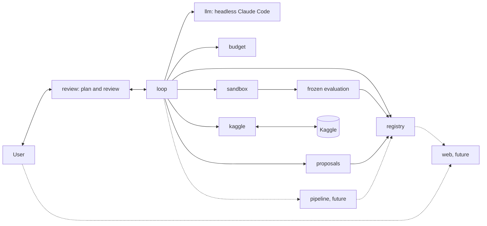

# Design of the data science agent for tabular Kaggle

This document is the design on which all later tickets are based. It does not implement the agent. For each choice it lists the alternatives considered and why they were rejected.

## 1. Goals and non-goals

**Goals**

- An agent that does the iterative work of a data scientist on a tabular Kaggle competition, from downloading the data to the submission.
- The user approves only a short initial plan; then the agent works autonomously (split, baseline, improvement iterations) and the user steps in only at the end of the cycle, by reviewing the report. Every attempt is tracked and can be consulted from a web interface.
- Fully automatic interaction with Kaggle: download, reading of rules and metric, sending of submissions, reading of the score.
- Runs on a Mac without GPU, with small or medium tabular datasets.
- No paid API: the model that reasons at runtime is headless Claude Code with the subscription.
- Metrics, validation schemes and techniques are not fixed in the design. The agent derives them from the problem (rules, nature of the data, type of target) and justifies them. The design defines how it chooses them, how it justifies them and how it avoids fooling itself.
- The design does not prevent the future predict + optimize vision (section 14).

**Non-goals**

- This ticket does not write modeling logic: it produces the document and an empty skeleton of the repo.
- No validation of the individual steps by the user: the control points are the initial plan and the final review (section 2).
- No polished graphic design of the interface: it is deferred to a later ticket.
- No support for GPU, deep learning on images or text, code competitions (notebook-only) or datasets that do not fit in memory on a Mac.
- No optimization for leaderboard rank at any cost: the agent must not sacrifice the validity of the evaluation to climb the leaderboard.

**Principle on the stack**

Python 3.12, pandas, scikit-learn, LightGBM and local MLflow are a **starting point, not a constraint**. The design does not fix them. Each development ticket chooses the libraries it needs, evaluating the alternatives at that time and documenting the choice. The selection criteria are:

1. works on a Mac without GPU;
2. no paid API or service;
3. tests run without network (the library must be able to be simulated or used offline);
4. low maintenance cost: widespread library, stable API, few transitive dependencies;
5. reproducibility: pinned versions and deterministic behavior for the same seed.

Rejected alternative: fixing the complete stack now in the design. Rejected because we do not yet know what will really be needed (for example whether pandas is enough or a faster alternative is worth it) and because a choice made with no code to write would be without evidence. For the same reason the first tickets declared no runtime dependencies; each library enters `pyproject.toml` with a pinned version in the ticket that needs it. So far the evaluation ticket confirmed pandas, numpy and scikit-learn (section 5).

## 2. Work cycle

The cycle is a state machine, implemented as fixed code in the `loop` subpackage. The state is persisted after every transition, so a crash does not lose work. The user approves only a short initial plan; then the agent works autonomously and the user steps in at the end of the cycle. The individual steps are not validated by the user.

States:

| State | Meaning | Who acts |
|---|---|---|
| `PLANNING` | the model analyzes problem and data and writes the short initial plan (section 4) | model |
| `AWAITING_PLAN_APPROVAL` | the plan is presented to the user, who approves or corrects it; it is the single point of control before the cycle | user |
| `SPLITTING` | the code creates the validation set, which drives the iterations, and the test holdout, never used to decide (section 5) | code |
| `BASELINE` | first model trained and evaluated on the validation set | code and model |
| `ITERATING` | improvement iteration, with the sub-steps `propose`, `validate`, `execute`, `analyze`, `record` | model and code |
| `REPORTING` | short final report and evaluation of the test holdout on the best attempt | code and model |
| `AWAITING_REVIEW` | the user accepts or gives suggestions | user |
| `STOPPED` | a stop criterion fired or the cycle ended (section 11) | code |

Happy path: `PLANNING → AWAITING_PLAN_APPROVAL → SPLITTING → BASELINE → ITERATING (N times) → REPORTING → AWAITING_REVIEW`. After the plan is approved there is no other approval state until the final review.

**Configurable parameters.** The number of iterations N (10 by default), the number K of consecutive iterations without real improvement after which the cycle stops early (section 11), and the cap on fix retries per attempt (3 by default).

**One iteration.** The model analyzes the metric and the errors (section 9), formulates a hypothesis, decides what to change (feature engineering, model, hyperparameters, data cleaning, etc.) and runs a new attempt. The code checks the shape of the attempt and duplicates, runs it in the sandbox with the frozen evaluation and records the outcome. Every iteration produces an attempt in the registry (section 7).

**Review at the end of the cycle.** The user accepts, or gives suggestions on what to explore. The suggestions are recorded and start a new cycle, which restarts from the existing state (best model and history of attempts) and skips the plan approval phase, except for a change of the protocol (section 5).

Unhappy cases:

- **Invalid or duplicate attempt proposal** (`validate`): back to `propose` with the reason for the rejection passed to the model. After a maximum number of consecutive rejections the iteration is recorded as `inconclusive` and the cycle goes on.
- **Execution error** (exception, memory, invalid code): code fixes are not attempts and do not consume one of the N iterations, because an attempt is one ML idea (features, model, hyperparameters, data cleaning). The agent fixes the code and reruns inside the same attempt, without approval, with a cap of 3 fix retries per attempt (configurable). Every run is recorded with its traceback. If the cap is exceeded the attempt is closed with outcome `failed` and `failure_kind = code_error`, and the agent goes on. A cap on consecutive attempts closed as failed stops the cycle: once it is exceeded the cycle moves to `REPORTING`.
- **Execution timeout**: the process is terminated, the attempt is `failed(timeout)`; the next attempt must estimate a lower cost or reduce the data.
- **Approval timeout**: applies only to the plan and the final review. The state stays waiting; there is no implicit approval. The cycle is suspended and can resume from the saved state.
- **Model error** (rate limit, malformed response): retry with backoff; if it persists, the cycle is suspended without losing the state and resumes from the saved state.

Rejected alternatives:

- *Human validation of every single step*: rejected because the requirement is that the user steps in only at the beginning and at the end; protection lies in the frozen evaluation, the sandbox and the recording of everything.
- *Separate approval of metric and validation*: rejected because the short plan already contains them and a single point of control is lighter for the user.
- *No control point*: rejected because a wrong metric or validation scheme invalidates the whole cycle; the approved plan is the minimum control.
- *Cycle without an iteration cap*: rejected because it consumes the subscription quota and favors overfitting on the validation set.
- *A generic agent framework with a dynamic graph*: rejected because it hides the transitions and makes it hard to guarantee that the evaluation is not bypassed; an explicit state machine is testable with fakes.
- *Unlimited automatic correction of errors*: rejected because the model could get around an evaluation error by changing the protocol instead of its code; hence the cap of fix retries per attempt and the cap on consecutive attempts closed as failed.
- *Every code fix recorded as a new attempt*: rejected because fixes would consume the N iterations and a crash is not a new idea; the fixes stay as execution records of the same attempt, so they remain traceable.

## 3. Work phases

The phases are not a rigid list: they form a graph. The agent can go back to any earlier phase when the evidence justifies it (e.g. the error analysis discovers a data quality problem). The return is decided by the agent without approval and recorded in the attempt with its rationale. The evaluation protocol is the exception: it is frozen (section 5).

| Phase | Input | Output | What the agent decides |
|---|---|---|---|
| Acquisition | competition identifier, credentials | raw data, data hash, rules, description of the metric | which files to download; nothing more, the rest is fixed code |
| Problem understanding | rules, description, raw data | summary of the problem: type of target, official metric, constraints (submission limits, external data) | interpretations of the rules, reported in the plan |
| Data exploration | raw data | profile: types, missing values, distributions, duplicates, hints of leakage, difference between train and test | targeted analyses and charts to produce |
| Initial plan | understood problem, data profile | short plan with metric and why, validation, feature engineering, models, baseline (section 4); with the approval the protocol is frozen | the complete plan, approved or corrected by the user |
| Split | approved plan | validation set for the iterations and untouched test holdout | nothing: it is fixed code |
| Baseline | data, frozen protocol | first model trained and evaluated, with its uncertainty | the simple baseline indicated in the plan |
| Iteration | previous outcomes, error analysis | an attempt with hypothesis, change and metrics | what to change: features, model, hyperparameters, data cleaning, without approval |
| Error analysis | out-of-sample predictions | weak segments, hypotheses (section 9) | new hypotheses for the earlier phases |
| Combination | candidate models | ensemble or selection | only if the models have different errors, with evidence |
| Report and pipeline | history of attempts, best attempt | short final report, test holdout, end-to-end pipeline (section 13), generated submission | which attempts to tell and which variants to propose |

The actual submission to Kaggle is not a phase of the autonomous cycle: it is an explicit action of the user after the review (section 10).

Rejected alternative: fixed linear pipeline (explore → features → model → submission). Rejected because real work goes back often and a rigid sequence forces useless steps or hides the return.

## 4. Proposal format

**Short initial plan.** After analyzing problem and data the agent writes a plan of at most one page, readable in 2 minutes. It is the only document the user approves or corrects before the cycle (section 2). It has five mandatory items:

1. metric and why;
2. validation scheme;
3. planned feature engineering;
4. models to try;
5. baseline.

The code (`proposals` subpackage) rejects incomplete or overlong plans; the length limit is `MAX_PLAN_WORDS` (300 words, a word count used as a proxy for the page). Example (abridged):

```yaml
metric: "official competition metric; it is the one that decides the leaderboard"
validation: "partitions that mimic the separation between train and test (evidence: comparison of the distributions)"
feature_engineering: ["missing-value indicators", "encoding of rare categories"]
models: ["boosted trees", "regularized linear model"]
baseline: "simple model with default parameters"
```

**Attempt.** After the plan every iteration is an attempt, that is a falsifiable hypothesis of the agent. It is not submitted to the user: the schema is validated by the code and the attempt is recorded. Fields:

- `id`, `phase`, `parent_id` (the attempt it descends from);
- `hypothesis`: a precise statement ("adding X improves Y because Z");
- `rationale` with `evidence`: in natural language, because it is shown in the web interface (section 13); references to attempts, charts or analyses that support it; a hypothesis without evidence must be marked `exploratory`;
- `what_changed`: what changes with respect to the `parent_id` attempt;
- `expected_effect`: direction and order of magnitude of the change of the frozen metric;
- `measure`: how it will be checked, in the frozen protocol, and which outcome falsifies the hypothesis;
- `estimated_cost`: compute time, subscription quota;
- `risks`: leakage, overfitting of the validation, instability, cost;
- `artifacts`: code (diff), configuration files, linked pipeline.

Example of an attempt (abridged):

```yaml
id: T-0014
phase: iteration
parent_id: T-0009
hypothesis: "Errors are concentrated in records with a missing value in 'column_a'; a missing-value indicator reduces the error in that segment."
rationale: "In attempt T-0009 the error is much higher where 'column_a' is missing."
evidence: ["T-0009/error_by_segment", "profile/missing_pattern"]
what_changed: "added a missing-value indicator feature; model and hyperparameters unchanged"
measure: "frozen metric on the validation set and on the segment; falsified if the improvement is below the significance threshold of the protocol"
```

Rejected alternatives: free text (not verifiable by the code, not deduplicable), code only without a hypothesis (the registry cannot remember what was meant to be learned) and a long, detailed plan (it cannot be read in 2 minutes and the user stops reviewing it).

## 5. Choice of the metric and the evaluation protocol

The design does not fix the metric, the validation scheme or the techniques. It describes the process by which the agent derives and justifies them.

**Derivation.** In the initial plan phase the agent derives the metric and the validation scheme from three sources, each cited as evidence:

1. *Rules and competition page*: the official evaluation metric, the submission format, any constraints. The official metric is the default; if the agent chooses a different development metric it must explain why (e.g. more stable) and how it relates to the official one.
2. *Nature of the data*: temporal dependence, groups or repeated entities, distribution of the target, size. From these the validation scheme is derived: it must mimic the way the test is separated from the train (chronological, by group, random). The agent cites the evidence (e.g. comparison between the train and test distributions, overlap of identifiers).
3. *Type of target*: type of problem, imbalance, heavy tails, which influence the stratification and the reading of the metric.

**Justification in the plan.** The justification of metric and validation is contained in the initial plan (section 4), which replaces the separate approval of metric and validation. The plan says which metric and scheme are chosen and why, the alternatives considered, the threshold with which an improvement is considered real (section 6) and the share of data kept as test holdout. The estimate of the protocol noise (variance across seeds and across partitions) is computed by the code on the baseline and recorded. The correlation between validation score and public score is a consistency check done after the review, if the user sends a submission.

**Split.** After the approval the code separates the data into a validation set, which drives the iterations, and a test holdout, which is never used to decide and is evaluated only at the end of the cycle (section 6). This avoids overfitting on the validation set.

**Protocol.** The plan stays human-readable text. Next to it the agent proposes a `Protocol` (in `evaluation`), a separate immutable record with the metric name and parameters, the direction, the target column, the partition scheme and its parameters for the validation folds and for the holdout, the holdout share, the seed, the number of repetitions and the factor `k` of the significance threshold (section 6). Every field is mandatory: there is no default metric, direction or scheme, and a protocol that leaves one out is rejected. Metrics and partition schemes are identified by name in two extensible registries in the fixed code of `evaluation` (the model cannot pass its own function). The building blocks are random partitions with optional stratification, partitions by group and chronological partitions; they are tools, not choices. Each metric declares its natural direction; the protocol states the direction explicitly and the code only checks that the two agree (a custom metric with a non-conventional direction is registered as a separate metric). The protocol must yield at least two validation partitions (repetitions times folds), otherwise the dispersion of the baseline is undefined.

**Repetitions.** Every repetition has its own partitions when the scheme is random or by group. A deterministic scheme (the chronological one) gives the same folds in every repetition and only the seed passed to the candidate changes; the dispersion of the baseline then measures the noise of the model seed. The seeds of the repetitions are derived from the seed of the protocol.

**Freezing.** With the approval of the plan the code computes a hash of the protocol (definition of the metric, partition scheme with seed, threshold, holdout) together with the evaluation code, and saves it on the cycle in the registry. The evaluation code is covered by the SHA-256 of the source files of the `evaluation` package, computed at runtime, so nobody has to bump a version constant; the flip side is that any edit of the package, even a reformat, invalidates the frozen protocols of open cycles. The versions of the libraries are not part of the hash (they are pinned and do not change inside a cycle); they are recorded in the resources of every execution. Every attempt recomputes the hash and compares it with the one stored on the cycle before starting, and before every holdout read; a different hash blocks the run, and a cycle without a frozen hash cannot be evaluated. The protocol stays frozen for the whole cycle: a change during the cycle is not allowed. If the evidence shows that it is inadequate, the agent says so in the final report with an explicit proposal, motivated by the evidence. If the user approved it in the review, it applies to the next cycle; the earlier results are marked as not comparable and the registry keeps both versions.

**Library decision (evaluation ticket).** Data enter the engine as pandas DataFrames, and pandas, numpy and scikit-learn are runtime dependencies pinned with `==`. They are judged on the criteria of section 1: they run on a Mac without GPU (1), are free (2), work offline and need no simulation in tests (3), are widespread with a stable API (4), and give deterministic results for the same seed (5). The package is the only code allowed to import them; `proposals` and `registry` stay on the standard library.

Rejected alternatives for this decision:

- *Pure Python for metrics and partitions*: rejected because reimplementing them is error-prone (ties, stratification, edge cases) and gives no benefit on the criteria.
- *polars or pyarrow instead of pandas*: rejected because they are further from the stack the generated code and Kaggle notebooks use, with no need shown by the data sizes in scope.
- *scipy alone*: rejected because it offers statistics but no ready-made partitioning and metric building blocks.
- *Adding LightGBM or MLflow now*: out of this ticket; the engine needs no model library (candidates are supplied by the caller) and MLflow was not adopted for the registry.

Rejected alternatives:

- *Metric and scheme decided a priori in the design (e.g. one choice valid for all competitions)*: rejected because it depends on the problem and violates the key principle.
- *Leaving the model free to change the metric during the cycle*: rejected because it allows searching for the metric that gives the best result, that is fooling itself.
- *Freezing forever without exceptions*: rejected because an error in the protocol (e.g. leakage discovered later) must be correctable; the way is the explicit proposal approved between one cycle and the next.
- *Separate approval of metric and validation before the plan*: rejected because the plan already contains them with their justification.

## 6. Real improvement, noise and overfitting

An increase in the score is not an improvement until it passes the following checks, all in the fixed code of `evaluation`.

- **Noise across seeds and partitions.** Every comparison reports the variation across repetitions (different seeds, different partitions). The baseline is measured several times to estimate its noise. The improvement is considered real only if it exceeds the significance threshold defined in the protocol (section 5). The engine implements one parametric form: in a paired comparison on the same partitions, the mean difference, oriented by the direction of the metric, must exceed `k` times the dispersion of the baseline, where the dispersion is the sample standard deviation across all its partitions (repetitions times folds). The agent proposes `k` for the problem with the plan, and it is frozen in the protocol; the engine has no default. With a deterministic scheme and several repetitions the folds are identical and only the seed of the candidate changes, so the dispersion of the baseline captures the noise of the model seed; if the candidate ignores the seed the dispersion is zero and any positive improvement passes, which is why the agent justifies the repetitions in the plan.
- **Paired comparisons.** Two candidates are compared on the same partitions, to reduce the variance of the difference.
- **Overfitting of the validation set.** Every attempt adapts the choice a little to the validation set. For this reason the registry counts how many comparisons have been made in the cycle (every comparison is stored with candidate, reference, difference, threshold and outcome). Raising the threshold with that count is not implemented yet: the count is recorded so the rule can be added later. The hyperparameter search happens inside the inner validation, not on the reference partition.
- **Untouched holdout.** The test holdout is not accessible to the model or to the generated code and is not used to decide. The cycle has one holdout session at the end of the cycle, in which the best attempt and the variants requested by the user (section 13) are evaluated together. Every read is logged in the registry before the data is returned, an attempt is read at most once per session, no read is possible after the session is closed and the session cannot be reopened in the same cycle. A failed evaluation still consumes the session, because its read is already logged. The reads do not influence the decisions. The guarantee of this design is one of interface and log: the split object exposes only development data and the holdout is reachable through a single accessor. Real isolation from generated code arrives with the sandbox (ticket 6); inside one Python process the accessor cannot prevent a determined reader. If the score on the holdout is much worse, the improvement is suspect and the report says so. With cycles repeated after the suggestions the risk of overfitting also on the holdout grows: the design records it as an open risk (section 16).
- **Early stop.** K consecutive iterations without real improvement, that is above the significance threshold, stop the cycle (section 11).
- **Overfitting of the public leaderboard.** The public score covers a part of the test, often small. It does not drive development decisions: it serves as a consistency check with the validation. The number of submissions is limited (section 10).
- **Leakage diagnosis.** A very large jump is treated as suspect and produces a verification attempt before it is accepted.

Rejected alternatives:

- *Choosing the candidate with the highest public leaderboard score*: rejected because with few submissions and a small test it selects noise.
- *A classical statistical test on a single run*: rejected because the partitions are not independent and the test would overestimate certainty; the empirical variation across repetitions is preferred.
- *No threshold, every increase is accepted*: rejected because it accumulates overfitting of the validation set.
- *Evaluating the holdout at every iteration*: rejected because it would turn it into a second validation set.
- *Raising the threshold with the number of comparisons right away*: postponed; the count is recorded so the rule can be added later.

## 7. Experiment registry

The registry (`registry` subpackage) is the memory of the agent and the source of data for the web interface (section 13). For each attempt it saves:

- `hypothesis` and `rationale` in natural language, with the `evidence` and the `exploratory` mark;
- originating attempt (`parent_id`) and what changes with respect to it (`what_changed`);
- complete configuration, seed, code hash, data hash, hash of the frozen protocol (the same hash is stored once on the cycle at approval);
- metrics per partition, mean and dispersion;
- duration and resources;
- outcome: `succeeded`, `failed`, `inconclusive`, with the free-text **reason** (traceback, hypothesis falsified, improvement below threshold) and a structured `failure_kind`;
- `artifacts`: code and diff, predictions, charts, pipeline reference (the linked pipeline, section 13);
- conclusion of the analysis: what was learned.

**Attempt and execution records.** The `Attempt` of section 4 is the proposal; what happened when it ran is an *execution record*, a separate type in `registry` linked to the attempt by its id. The configuration, seed, hashes, metrics, duration, resources, outcome, `failure_kind`, reason and artifacts belong to the execution record. One attempt has one or more execution records: the initial run plus any code-fix retries (section 2). The registry stores all of them, so fixes are traceable, and the outcome of the attempt is the outcome of its last execution. An attempt is final only when it is closed with its conclusion; an open attempt has no outcome and does not appear in outcome or failure queries.

**Failure kind.** `failure_kind` has the values `code_error`, `hypothesis_falsified`, `timeout` and `below_threshold`. It is required when the outcome is not `succeeded` and absent when it is `succeeded`. The free-text reason is kept as well. `code_error` has two meanings. On an execution record it only means that this run crashed. At attempt level, once the attempt is closed, it means that the code still failed after the cap of fix retries, and the registry refuses to close an attempt as `code_error` before the cap is reached. The registry can list failures by `failure_kind`, so the agent avoids retrying falsified hypotheses and the web interface can filter them.

Known open point: an iteration recorded as `inconclusive` after repeated rejected proposals (section 2) has no execution and no fitting `failure_kind`, so it cannot be represented by an execution record. It is settled in the loop ticket.

**Evaluation records.** For the evaluation engine (section 6) the registry also stores, per cycle: the frozen protocol hash; the holdout session (opened and closed times; at most one per cycle, never reopened); the log of holdout reads (attempt, number of rows, time), accepted only while the session is open; and the paired comparisons with their count. These are append-only and the rules about who may read or compare are applied by the engine, not by the registry. SQLite files created before this change are migrated by adding the hash column.

**Cycle and suggestions.** A cycle has an identifier, approved plan, parameters (N, K, cap of fix retries), state and, once approved, the frozen protocol hash. A user suggestion has text, origin cycle and the cycles spawned from it. A new cycle restarts from the best model and the history, and the suggestion stays recorded together with the cycles it generated.

**Required queries.** The registry must support the queries of the web interface: list of attempts, series of the metric per iteration, detail of an attempt, suggestions and linked cycles.

**Deduplication.** Two levels: (1) a deterministic *fingerprint* (hash of normalized configuration, code, data and protocol) discards exact duplicates; the code hash is included because features and models live in the code, so the same configuration with different feature code is a different idea. The check runs when a new attempt is proposed, against all previous attempts whatever their outcome; the fix retries of the same attempt are not checked against each other; (2) a semantic check: before proposing, the model receives a summary of the related attempts and must declare how the new attempt differs. The code rejects attempts without this declaration.

**Memory of failures.** Failures enter the context of `propose` as a compact list "what was tried, outcome, why"; an attempt that failed because of a code error is distinguished from one that failed because the hypothesis was wrong, through `failure_kind`.

**Replaceable interface.** The registry sits behind an interface (`Registry`), so the storage can be replaced.

Alternatives considered:

- *Local MLflow*: good interface and comparison of runs, but a heavy dependency and less suited to saving hypotheses, cycles and suggestions.
- *Own registry (SQLite or JSONL)*: simple, inspectable, no dependencies, but the visualization part must be written.
- *Both*: the own one as the source of truth and MLflow as an optional view.

**Decision (registry ticket).** SQLite through the standard library `sqlite3` is the source of truth behind the interface. It needs no dependency and no network, it is cheap to maintain (stable API, nothing to pin) and it is reproducible and inspectable; UNIQUE constraints and transactions enforce deduplication and referential integrity. Rejected: local MLflow, because of its many transitive dependencies and poor fit for cycles, suggestions and hypotheses (it stays possible as an optional view behind the same interface, outside this ticket); JSONL, because it has no transactions or unique indexes; and using both now, because there is no need yet for the second one. Rejected for now: memory entrusted only to the model context, because it is lost between sessions and is not verifiable.

## 8. Roles: model and deterministic code

**The model decides and writes:** hypotheses, rationales, code of the iterations (features and models), interpretation of the results and the initial plan. It is creative but not reliable.

**The fixed code (not modifiable by the model):** cycle and state machine, split, computation of the metric, significance threshold, holdout, access to Kaggle and credentials, budget, registry, hashes.

**The user:** approves or corrects the initial plan and reviews the final report (accepts or gives suggestions). Does not validate the individual steps.

**How the model is prevented from altering the evaluation:**

1. the generated code runs in a sandbox (`sandbox` subpackage) that receives only the training data and a narrow interface: a function that builds the features and a model; the partition and the metric are executed outside the sandbox;
2. the evaluation files are read-only or outside the writable tree; the model has no permissions on the paths of the fixed code;
3. before every attempt the code checks the hash of the evaluation files and of the protocol; a difference blocks the run;
4. the test holdout data and the test labels do not exist in the sandbox; the holdout is read only by the fixed code at the end of the cycle and every read is logged;
5. the headless Claude Code process has tool permissions limited to the workspace of the run; changes outside it are rejected and logged;
6. with no human rereading the diffs, the code automatically rejects code that touches protected files and records the diff in the attempt, so every change can be reconstructed afterwards.

Rejected alternatives:

- *Trusting instructions in the prompt ("do not modify the evaluation")*: rejected because it is not a control, only a request.
- *Letting the model also write the evaluation and reviewing it by hand*: rejected because every change must be reread, it does not scale and a subtle error goes unseen.
- *Isolation with a container for each run*: postponed; costly on a Mac. The sandbox starts as a separate process with reduced permissions and can evolve.

## 9. Error analysis

After every significant attempt the code produces, from the out-of-sample predictions:

- distribution of the residuals and relation with the features;
- error by subgroup (categories, value ranges, missing values, periods, groups);
- worst examples and label ambiguities;
- comparison between the errors of different models (useful for the combination);
- gap between partitions, to reveal instability.

The code computes the tables; the model interprets them and turns them into the hypothesis of the next iteration, in the format of section 4, citing the table as evidence. The analysis does not go through the human and is linked to the attempt that produced it, so it stays consultable. Examples: a segment with a high error suggests new features or a dedicated model; an error correlated with time suggests revising the validation scheme (to be flagged as an explicit proposal in the final report, because the protocol is frozen, section 5); inconsistent labels suggest data cleaning.

Rejected alternatives: letting the model choose each analysis from scratch (not repeatable and not comparable across experiments), and a global-only analysis with the metric (hides where the model is wrong).

## 10. Kaggle integration

Access to Kaggle is fixed code in the `kaggle` subpackage, behind an interface that the tests replace with a fake.

- **Download**: the client downloads the competition files into the `data/` folder (ignored by git) and saves their hash.
- **Rules and metric**: the client downloads description, rules page and evaluation page; the model reads them and derives a summary, which goes into the initial plan approved by the user (section 4). The acceptance of the rules, if needed, is a manual step of the human.
- **Submission**: the pipeline generates the file; the fixed code validates the format of the file (columns, rows, identifiers) before sending it, then sends it and reads the score status until completion or timeout.
- **Score**: read and recorded together with the submission, never used to change the protocol.
- **Daily limit**: the code knows the limit and the submissions left. A submission is used only when it is worthwhile: a candidate exceeds the significance threshold on the validation set with respect to the one already sent, or the consistency between validation and public score needs checking (the first submission, a change of model family, a suspicion of leakage). A reserve is kept for the last hours. The actual submission to Kaggle is not part of the autonomous cycle: the submission is generated by the pipeline (section 13), but sending remains an explicit action of the user after the review and respects these rules.
- **Credentials**: they live outside the repo (`~/.kaggle/kaggle.json` with `600` permissions, or environment variables) and `kaggle.json` and `.env` are in the `.gitignore`. Only the Kaggle client reads them; they do not enter the model context, do not appear in the logs or in the registry and are not passed to the sandbox, which has no network access to Kaggle. A check looks for key-like strings in the artifacts before saving them.

Rejected alternatives:

- *The model uses the Kaggle CLI directly*: rejected because it would have access to the credentials and could exhaust the submissions.
- *Sending at every improvement*: rejected because it consumes the limit and pushes toward leaderboard overfitting.
- *Credentials in an encrypted file of the repo*: rejected, the risk of an accidental commit remains; better outside the repo.

## 11. Stop criteria and budget

The budget is fixed code in the `budget` subpackage, configured by the human at the beginning and checked before every iteration.

- **Iterations**: the number of iterations of the cycle is 10 by default and is configurable; there is also a cap on consecutive attempts closed as failed, distinct from N and K, and a cap of fix retries per attempt (3 by default, configurable; section 2). Code fixes do not consume iterations.
- **Time**: maximum total time and per single run.
- **Submissions**: total maximum and daily reserve (section 10).
- **Subscription**: consumption of the Claude Code quota, measured with the number of calls and tokens reported by the adapter; warning threshold and stop threshold. In case of rate limit, the agent waits according to the backoff and suspends the cycle without losing the state.
- **Early stop for stagnation**: if for K consecutive iterations there is no real improvement (section 6), the cycle stops automatically and moves to the final report without user intervention. K is configurable.
- **Stop on target**: target score declared by the human reached; the cycle moves to the report.

Rejected alternatives: leaving to the user the decision to stop at every stagnation (contradicts autonomous work), no limit with manual stop (risk of consuming the quota without noticing), and a single limit on time (it protects neither the subscription nor the submissions).

## 12. Reproducibility

- All seeds are part of the configuration and saved in the registry; the partitions are deterministic from the seed of the protocol.
- The environment is pinned with a lockfile; versions of Python and of the libraries are saved for every run.
- Hashes of the data, of the generated code and of the protocol; the generated code is saved as an artifact, not only as text in the registry.
- Every run saves a manifest with everything needed to rerun it; a replay command reruns an attempt (also from its pipeline) and compares the result with the recorded one.
- **Pipeline.** Every delivered pipeline (section 13) has fixed seeds, declared dependencies, is launched with a single command and depends neither on notebooks nor on in-memory state.
- The non-determinism of the model (the hypotheses) is not reproducible, but the whole conversation and the decisions are saved, so the history can be reconstructed.

Rejected alternative: reproducing by rerunning the model with the same prompt, because it is not deterministic; the execution is reproduced, not the hypothesis.

## 13. Human interaction

The user steps in at three moments, in the `review` subpackage:

1. **Short plan**: the user approves or corrects the initial plan (section 4). It is the single point of control before the cycle.
2. **Short final report**: best attempt, result on the test holdout, what worked and what did not.
3. **Review**: the user accepts, or gives suggestions on what to explore. Every suggestion is recorded and starts a new cycle from the existing state (section 7). Every answer is saved in the registry.

### Deliverable: the pipeline

The final output of every cycle is an executable end-to-end Python pipeline, or N pipelines if the user wants to keep several variants for comparison (for example the best one and a simpler alternative). Each pipeline:

- covers data loading, preprocessing, feature engineering, training, evaluation, prediction and submission;
- is launched with a single command and is reproducible: fixed seeds, declared dependencies, no notebook and no in-memory state (section 12);
- is linked to the attempt it comes from: the attempt records the reference to the pipeline (section 7) and from the interface one goes from the attempt to the corresponding pipeline.

### Web consultation interface

The web interface can be consulted without reading code and reads the data from the registry. The views are:

- **list/timeline of attempts**, with outcome, metric and originating attempt;
- **chart of the metric per iteration**, with the best attempt highlighted;
- **detail of each attempt**: hypothesis, rationale in natural language, what changes with respect to the originating attempt, configuration, metrics, duration, outcome, artifacts and link to the pipeline;
- **user suggestions**, with the cycles spawned from each.

The polished graphic design is deferred to a later ticket: in this design the completeness and navigability of the data matter, not the appearance.

Rejected alternatives: batch approval of proposals (contradicts autonomous work and the user does not see the effect of each one), a web interface only for approval (traceability requires mostly consultation), a report only in Markdown (it does not allow navigating between attempts, suggestions and cycles) and a polished graphic design right away (deferred).

## 14. Architecture and repository structure



Existing subpackages under `src/kaggle_agent/`:

- `loop`: state machine (section 2);
- `proposals`: schema and validation of plan, attempts and suggestions (sections 4 and 7);
- `evaluation`: protocol, registries of metrics and partition schemes, frozen split, holdout accessor and session, threshold and paired comparison, evaluation engine, hash of protocol and code (sections 5 and 6); the only package that imports pandas, numpy and scikit-learn;
- `registry`: registry of attempts, execution records, cycles and suggestions behind a replaceable interface, with a SQLite implementation, fingerprint and deduplication (section 7);
- `kaggle`: client and fake (section 10);
- `llm`: adapter for headless Claude Code, with fake;
- `sandbox`: execution of the generated code (section 8);
- `review`: initial plan and final review (section 13);
- `budget`: limits and stop (section 11).

Future subpackages, not created in this ticket and with names to be confirmed in review: `pipeline` for the generation of the end-to-end pipeline (section 13) and `web` for the consultation interface (section 13).

Other folders: `docs/` (design), `tests/`, `data/` (ignored by git).

**Extension point for predict + optimize.** After the prediction, a future phase will be able to estimate the uplift and optimize the allocation of a budget. It plugs in as a new subpackage (for example `decision`) that consumes the recorded predictions and as a new phase in the graph of section 3, with its own hypotheses and its own frozen protocol. It is not designed here; the design only ensures that the predictions are saved as artifacts and that phases and protocols are extensible.

Rejected alternatives: a single monolithic module (it does not allow protecting the evaluation) and one package per work phase (the phases are data in the graph, not separate code).

## 15. Implementation plan

Sequence of successive tickets. Principle: each ticket that introduces a dependency chooses the library among its own tasks, with the alternatives evaluated according to the criteria of section 1 (the starting stack is a starting point that is not binding). All tests run without network: Kaggle and Claude have a fake (simulation) and no test contacts them. The order puts first what protects the evaluation and gives priority to traceability.

1. **Data model of plan, attempt and suggestion.** Goal: schema and validation of the short plan (five items, length limit), of the attempt and of the suggestion. Acceptance criteria: incomplete or overlong plans rejected; attempts without `what_changed` rejected; serialization and rereading identical; examples of section 4 valid.
2. **Attempt registry with traceability.** Goal: registry with a replaceable interface (SQLite chosen over MLflow and JSONL, with the alternatives evaluated), execution records, cycles and suggestions. Acceptance criteria: all fields of section 7 saved and reread; exact duplicates (fingerprint including the code hash) rejected; failures retrievable by `failure_kind` with the reason; queries for list, metric series, detail, suggestions and linked cycles.
3. **Evaluation engine with frozen split.** Goal: a `Protocol` proposed with the plan and frozen at approval, metric and partition scheme chosen by name from extensible registries (none is a default), validation and holdout split, threshold `k` times the baseline dispersion, holdout session, hash of protocol and evaluation code stored on the cycle; pandas, numpy and scikit-learn confirmed as pinned runtime dependencies. Acceptance criteria: run blocked if the hash changes (protocol or evaluation code); same seed, same split; protocols without metric, direction or scheme rejected; deterministic schemes accept repetitions and only the candidate seed changes; holdout reachable only through an accessor that logs every read in the registry, one session per cycle, failed evaluation consuming it, and the limit that real isolation comes with the sandbox; threshold applied on paired comparisons and comparisons counted without raising the threshold yet; tests with fake candidates, without network.
4. **Kaggle client with fake.** Goal: download, rules, submission, score, daily limit. Acceptance criteria: all tests use the fake and no network; submission format validated; limit respected; credentials absent from the logs.
5. **Headless Claude adapter with fake.** Goal: call Claude Code non-interactively and read its outcome. Acceptance criteria: fake that simulates responses, malformed responses and rate limit; consumption recorded; no test calls Claude and no network.
6. **Execution sandbox.** Goal: run the generated code with reduced permissions. Acceptance criteria: timeout applied; writing to protected files impossible and diff touching them rejected; no access to credentials and holdout.
7. **State machine of the autonomous cycle.** Goal: plan, baseline, N iterations, early stop and resume. Acceptance criteria: happy path with fake model and user; default of 10 configurable iterations; stop after K iterations without improvement; code errors fixed inside the attempt up to the fix-retry cap, then the attempt is closed as `failed` with `code_error`, and a cap on consecutive failed attempts; resume from the saved state.
8. **End-to-end pipeline generator linked to the attempt.** Goal: produce the executable pipeline (and N variants on request). Acceptance criteria: a single command; seeds and dependencies declared; no notebook; reference recorded in the attempt; replay that reproduces the metric.
9. **Budget and stop.** Goal: limits and stop criteria. Acceptance criteria: every limit blocks the cycle; stagnation detected; rate limit handled with simulated wait.
10. **Final report and review with suggestions and new cycles.** Goal: short report, holdout evaluation, acceptance or suggestions. Acceptance criteria: the report contains best attempt, result on the test holdout, what worked and what did not; a suggestion is recorded and starts a cycle from the best model and the history.
11. **Web interface for consultation.** Goal: views of list/timeline, metric chart, detail and suggestions. Acceptance criteria: the four views show the registry data; the detail shows the rationale and the link to the pipeline; tests without network.
12. **Orchestrator and first end-to-end competition.** Goal: connect the components and complete a tabular competition chosen by the user, with fakes in the tests and real Kaggle by hand. Acceptance criteria: complete cycle with the fakes; a real submission sent by the user after the review; reproducible registry and pipeline.

A later ticket, outside this plan, covers the polished graphic design of the interface.

Rejected alternative: a single large implementation ticket, because it is not reviewable.

## 16. Open risks and questions for the human

**Open risks**

- The behavior of headless Claude Code with the subscription (limits, rate limit, tool permissions, long autonomous cycles) cannot be verified in this environment without network; it must be confirmed in the adapter ticket.
- Divergence of an autonomous cycle: without intermediate controls the cycle can go in useless directions; mitigations are the iteration cap, the early stop, the cap on consecutive failures and traceability.
- Isolation of the holdout: until the sandbox exists, the protection of the holdout is an interface and a log, not a barrier against code in the same process.
- The hash covers the bytes of the `evaluation` sources, so any edit of the package invalidates the frozen protocols of open cycles, and a change of library versions in the middle of a cycle is recorded but not blocked.
- Overfitting on the holdout: the holdout is read at the end of every cycle, so with repeated cycles it grows. The design logs every read but does not solve it (for example with a new holdout): open point.
- Quality of the short plan: a poor or wrong plan, approved in a hurry, conditions the whole cycle.
- Cost in subscription quota per autonomous cycle, unknown.
- The rules of some competitions forbid external data or limit automation; the reading of the rules done by the model can be wrong, which is why it goes into the plan the user approves.
- The sandbox on a Mac without containers offers partial isolation.
- The public leaderboard can be poorly informative; the protocol tries not to depend on it.
- The test of the document checks structure and keywords, not quality: human review remains necessary.

**Starting-point libraries:** pandas, numpy and scikit-learn were confirmed in the evaluation ticket (section 5) and are pinned in `pyproject.toml`. LightGBM is still to be confirmed in the ticket that uses it. MLflow was not adopted for the registry (section 7) and remains only an optional future view.

**Questions for the human**

1. Which competition is the first one to tackle end-to-end?
2. How much subscription quota is acceptable per competition?
3. How many submissions per day are you willing to use, and what reserve to keep?
4. Is a web interface for consulting the attempts acceptable, with plan approval and review outside the web?
5. Is it acceptable for code errors to be fixed automatically inside the same attempt, with a cap of fix retries per attempt (now 3) and a cap on consecutive attempts closed as failed, and which caps?
6. Are external data or pre-trained models allowed when the competition permits them?
7. Which default values for the number of iterations N (now 10) and for K of the early stop?
8. Do you want several pipelines per cycle and which variants to keep (for example the best one and a simpler one)?
9. Should the submission to Kaggle be done after the review, as an explicit action of the user?
