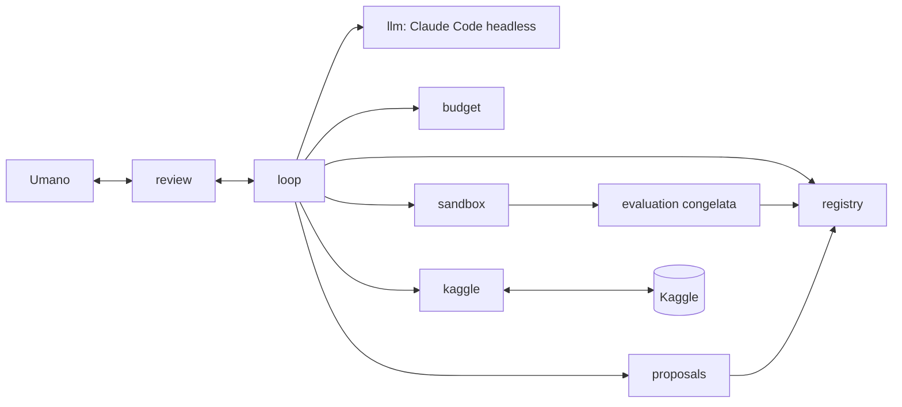

# Design dell'agente data science per Kaggle tabellare

Questo documento è il design su cui si basano tutti i ticket successivi. Non implementa l'agente. Per ogni scelta indica le alternative considerate e perché sono state scartate.

## 1. Obiettivi e non-obiettivi

**Obiettivi**

- Un agente che fa il lavoro iterativo di un data scientist su una competizione Kaggle tabellare, dal download dei dati alla submission.
- Ad ogni passo l'agente propone un'ipotesi, un umano la approva, l'agente la esegue, ne analizza i risultati e propone il passo successivo.
- Interazione con Kaggle completamente automatica: download, lettura di regole e metrica, invio delle submission, lettura del punteggio.
- Gira su un Mac senza GPU, con dataset tabellari di dimensione piccola o media.
- Nessuna API a pagamento: il modello che ragiona a runtime è Claude Code headless con la subscription.
- Metriche, schemi di validazione e tecniche non sono fissati nel design. L'agente li ricava dal problema (regole, natura dei dati, tipo di target) e li motiva. Il design definisce come li sceglie, come li giustifica e come evita di ingannare sé stesso.
- Il design non impedisce la visione futura predict + optimize (sezione 14).

**Non-obiettivi**

- Questo ticket non scrive logica di modellazione: produce il documento e uno scheletro vuoto della repo.
- Nessuna autonomia completa ora: l'approvazione umana c'è a ogni passo. L'autonomia futura è un cambio di policy nel ciclo (sezione 2), non una riscrittura.
- Nessun supporto a GPU, deep learning su immagini o testo, competizioni a codice (notebook-only) o dataset che non entrano in memoria su un Mac.
- Nessuna ottimizzazione per la posizione in classifica a ogni costo: l'agente non deve sacrificare la validità della valutazione per salire nel leaderboard.

**Principio sullo stack**

Python 3.12, pandas, scikit-learn, LightGBM e MLflow locale sono un **punto di partenza, non un vincolo**. Il design non li fissa. Ogni ticket di sviluppo sceglie le librerie di cui ha bisogno, valutando le alternative in quel momento e documentando la scelta. I criteri di scelta sono:

1. funziona su Mac senza GPU;
2. nessuna API o servizio a pagamento;
3. i test girano senza rete (la libreria deve poter essere simulata o usata offline);
4. costo di manutenzione basso: libreria diffusa, API stabile, poche dipendenze transitive;
5. riproducibilità: versioni bloccate e comportamento deterministico a parità di seed.

Alternativa scartata: fissare ora lo stack completo nel design. Scartata perché ancora non sappiamo cosa servirà davvero (per esempio se pandas basta o se conviene un'alternativa più veloce) e perché una scelta fatta senza codice da scrivere sarebbe senza evidenza. Per lo stesso motivo `pyproject.toml` non dichiara dipendenze di runtime.

## 2. Ciclo di lavoro

Il ciclo è una macchina a stati, implementata come codice fisso nel sottopacchetto `loop`. Lo stato è persistito dopo ogni transizione, così un crash non perde il lavoro.

Stati:

| Stato | Significato | Chi agisce |
|---|---|---|
| `PROPOSING` | il modello genera una proposta nel formato della sezione 4 | modello |
| `VALIDATING` | il codice controlla lo schema della proposta, i duplicati e il budget | codice |
| `AWAITING_APPROVAL` | la proposta è presentata all'umano | umano |
| `EXECUTING` | il codice generato gira nella sandbox con la valutazione congelata | codice |
| `ANALYZING` | il modello interpreta i risultati, il codice verifica i numeri | modello e codice |
| `RECORDING` | esito scritto nel registro | codice |
| `STOPPED` | un criterio di stop è scattato (sezione 11) | codice |

Transizioni principali: `PROPOSING → VALIDATING → AWAITING_APPROVAL → EXECUTING → ANALYZING → RECORDING → PROPOSING`.

Casi non felici:

- **Proposta non valida o duplicata** (`VALIDATING`): ritorno a `PROPOSING` con il motivo del rifiuto passato al modello. Dopo un numero massimo di tentativi consecutivi, stop con richiesta di intervento umano.
- **Rifiuto umano senza feedback**: la proposta è registrata come `rejected` e si torna a `PROPOSING`; il modello sa che quella direzione non è gradita.
- **Rifiuto con feedback**: il motivo è registrato e fa parte del contesto della proposta successiva. Se l'umano modifica la proposta, la versione modificata riparte da `VALIDATING`.
- **Errore di esecuzione** (eccezione, memoria, codice non valido): il run è registrato come `failed` con traceback e causa. Il modello può proporre una correzione, ma è una nuova proposta e passa dall'approvazione, tranne per correzioni banali (es. refuso) in una policy esplicita e limitata a un solo tentativo automatico.
- **Timeout** di esecuzione: il processo è terminato, il run è `failed(timeout)`; la proposta successiva deve stimare un costo inferiore o ridurre i dati.
- **Timeout dell'approvazione**: la proposta resta in `AWAITING_APPROVAL`; non c'è approvazione implicita. Il ciclo si sospende e può riprendere dallo stato salvato.
- **Errore del modello** (rate limit, risposta malformata): ritentativo con backoff; se persiste, il ciclo si sospende senza perdere lo stato.

Alternative scartate:

- *Esecuzione automatica con approvazione solo a posteriori*: scartata perché il requisito è l'approvazione a ogni passo, e perché un passo costoso o rischioso non è reversibile.
- *Un framework di agenti generico con grafo dinamico*: scartato perché nasconde le transizioni e rende difficile garantire che la valutazione non sia bypassata; una macchina a stati esplicita è testabile con fake.
- *Correzione automatica illimitata degli errori*: scartata perché il modello potrebbe aggirare un errore di valutazione modificando il protocollo invece del suo codice.

## 3. Fasi del lavoro

Le fasi non sono una lista rigida: formano un grafo. L'agente può proporre di tornare a qualunque fase precedente quando l'evidenza lo giustifica (es. l'analisi degli errori scopre un problema di qualità dei dati). Il ritorno è comunque una proposta approvata.

| Fase | Input | Output | Cosa può proporre l'agente |
|---|---|---|---|
| Acquisizione | identificativo della competizione, credenziali | dati grezzi, hash dei dati, regole, descrizione della metrica | quali file scaricare; nulla di più, il resto è codice fisso |
| Comprensione del problema | regole, descrizione, dati grezzi | sintesi del problema: tipo di target, metrica ufficiale, vincoli (es. limiti di submission, dati esterni consentiti o no) | interpretazioni delle regole da far confermare all'umano |
| Esplorazione dei dati | dati grezzi | profilo: tipi, valori mancanti, distribuzioni, duplicati, indizi di leakage, differenza tra train e test | analisi mirate e grafici da produrre |
| Protocollo di valutazione | problema compreso, profilo dei dati | metrica e schema di validazione motivati, soglia di significatività, holdout (sezione 5) | il protocollo completo, che poi viene congelato |
| Baseline | dati, protocollo congelato | punteggio di riferimento con la sua incertezza | una o più baseline semplici da confrontare, con la motivazione |
| Feature e pulizia | dati, baseline, esiti precedenti | nuove feature o trasformazioni, con effetto misurato | ipotesi su pulizia, codifica, feature, trattamento dei mancanti |
| Modellazione | feature, protocollo | modelli candidati con punteggi | famiglie di modelli, regolarizzazione, ricerca di iperparametri entro budget |
| Analisi degli errori | predizioni fuori campione | segmenti deboli, ipotesi (sezione 9) | nuove ipotesi per le fasi precedenti |
| Combinazione | modelli candidati | ensemble o selezione | solo se i modelli hanno errori diversi, con evidenza |
| Submission | modello scelto, previsioni sul test | submission inviata e punteggio pubblico letto | se e quando usare una submission (sezione 10) |

Alternativa scartata: pipeline lineare fissa (esplora → feature → modello → submission). Scartata perché il lavoro reale torna indietro spesso e una sequenza rigida costringe a passi inutili o a nascondere il ritorno.

## 4. Formato di una proposta

Ogni proposta è un'ipotesi falsificabile, non un'istruzione. Lo schema è validato dal codice (sottopacchetto `proposals`); una proposta senza tutti i campi non arriva all'umano.

Campi:

- `id`, `fase`, `parent_id` (proposta o esperimento da cui discende);
- `ipotesi`: un'affermazione precisa («aggiungere X migliora Y perché Z»);
- `motivazione` con `evidenza`: riferimenti a esperimenti, grafici o analisi del registro che la supportano; un'ipotesi senza evidenza va marcata come `esplorativa`;
- `effetto_atteso`: direzione e ordine di grandezza della variazione della metrica congelata;
- `misura`: come si verificherà, nel protocollo congelato, e quale esito falsifica l'ipotesi;
- `costo_stimato`: tempo di calcolo, numero di submission, quota di subscription;
- `rischi`: leakage, overfitting della validazione, instabilità, costo;
- `artefatti`: codice proposto (diff), file di configurazione.

Esempio (abbreviato):

```yaml
id: P-0014
fase: feature
parent_id: E-0009
ipotesi: "Gli errori sono concentrati nei record con valore mancante in 'colonna_a'; un indicatore di mancanza riduce l'errore in quel segmento."
evidenza: ["E-0009/error_by_segment", "profilo/missing_pattern"]
effetto_atteso: "miglioramento piccolo della metrica globale, grande nel segmento"
misura: "metrica congelata sui fold e sul segmento; falsificata se il miglioramento è sotto la soglia di significatività del protocollo"
costo_stimato: {tempo_min: 3, submission: 0}
rischi: ["l'indicatore potrebbe codificare un artefatto di raccolta dati assente nel test"]
```

Alternative scartate: testo libero (non verificabile dal codice, non deduplicabile) e solo codice senza ipotesi (l'umano non può valutare il perché e il registro non può ricordare cosa si voleva imparare).

## 5. Scelta della metrica e del protocollo di valutazione

Il design non fissa metrica, schema di validazione o tecniche. Descrive il processo con cui l'agente li ricava e li giustifica.

**Derivazione.** Nella fase di protocollo l'agente produce una proposta di tipo speciale (`protocollo`) a partire da tre fonti, ciascuna citata come evidenza:

1. *Regole e pagina della competizione*: la metrica ufficiale di valutazione, il formato della submission, eventuali vincoli. La metrica ufficiale è il default; se l'agente propone una metrica di sviluppo diversa deve spiegare perché (es. più stabile) e come si relaziona a quella ufficiale.
2. *Natura dei dati*: dipendenza temporale, gruppi o entità ripetute, distribuzione del target, dimensione. Da questi si deriva lo schema di validazione: la validazione deve imitare il modo in cui il test è separato dal train (cronologico, per gruppo, casuale). L'agente cita l'evidenza (es. confronto tra le distribuzioni di train e test, controllo della sovrapposizione degli identificativi).
3. *Tipo di target*: tipo di problema, sbilanciamento, code pesanti, che influenzano la stratificazione e la lettura della metrica.

**Giustificazione all'umano.** La proposta di protocollo contiene: metrica e schema scelti, le alternative considerate e perché scartate, la stima del rumore del protocollo (varianza tra seed e tra partizioni), la soglia con cui un miglioramento è considerato reale (sezione 6), la quota di dati tenuta come holdout, e un controllo di coerenza: la correlazione tra punteggio di validazione e punteggio pubblico è controllata dopo le prime submission.

**Congelamento.** Dopo l'approvazione, il codice calcola un hash del protocollo (definizione di metrica, schema di partizione con seed, soglia, holdout, versione del codice di valutazione) e lo salva nel registro. Ogni run verifica l'hash prima di partire; un hash diverso blocca il run. Il protocollo resta congelato per quella competizione. Cambia solo con una nuova proposta esplicita di tipo `protocollo`, con la motivazione dell'evidenza che lo rende inadeguato, approvata dall'umano. Dopo il cambio, i risultati precedenti sono marcati come non confrontabili e il registro conserva entrambe le versioni.

Alternative scartate:

- *Metrica e schema decisi a priori nel design (es. una scelta valida per tutte le competizioni)*: scartata perché dipende dal problema e viola il principio chiave.
- *Lasciare al modello libertà di cambiare metrica durante il lavoro*: scartata perché permette di cercare la metrica che dà il risultato migliore, cioè di ingannare sé stesso.
- *Congelare per sempre senza eccezioni*: scartata perché un errore del protocollo (es. leakage scoperto dopo) deve poter essere corretto; la via è la proposta esplicita approvata.

## 6. Miglioramento reale, rumore e overfitting

Un aumento del punteggio non è un miglioramento finché non supera le verifiche seguenti, tutte nel codice fisso di `evaluation`.

- **Rumore tra seed e partizioni.** Ogni confronto riporta la variazione tra ripetizioni (seed diversi, partizioni diverse). La baseline è misurata più volte per stimare il suo rumore. Il miglioramento è considerato reale solo se supera la soglia di significatività definita nel protocollo (sezione 5), per esempio in rapporto alla dispersione stimata; la forma esatta della soglia è decisa dall'agente per quel problema e approvata.
- **Confronti appaiati.** Due candidati sono confrontati sulle stesse partizioni, per ridurre la varianza della differenza.
- **Overfitting della validazione.** Ogni esperimento adatta un po' la scelta alla validazione. Per questo il registro conta quanti confronti sono stati fatti e la soglia può essere alzata al crescere del numero di confronti. La ricerca di iperparametri avviene dentro la validazione interna, non sulla partizione di riferimento.
- **Holdout intoccato.** Una quota di dati è messa da parte nel protocollo; non è accessibile al modello né al codice generato. Viene valutata solo su richiesta esplicita del codice fisso, per pochi candidati finali, e ogni lettura è registrata. Se il punteggio sull'holdout è molto peggiore, il miglioramento è sospetto.
- **Overfitting del leaderboard pubblico.** Il punteggio pubblico riguarda una parte del test, spesso piccola. Non guida le decisioni di sviluppo: serve come controllo di coerenza con la validazione. Una submission che migliora il pubblico ma peggiora la validazione non viene preferita. Il numero di submission è limitato (sezione 10).
- **Diagnosi di leakage.** Un salto molto grande è trattato come sospetto e produce una proposta di verifica prima di essere accettato.

Alternative scartate:

- *Scegliere il candidato col punteggio più alto sul leaderboard pubblico*: scartata perché con poche submission e test piccolo seleziona il rumore.
- *Un test statistico classico su una singola esecuzione*: scartato perché le partizioni non sono indipendenti e il test sovrastimerebbe la certezza; si preferisce la variazione empirica tra ripetizioni.
- *Nessuna soglia, si accetta ogni aumento*: scartata perché accumula overfitting della validazione.

## 7. Registro degli esperimenti

Il registro (sottopacchetto `registry`) è la memoria dell'agente. Per ogni proposta ed esperimento salva:

- ipotesi, motivazione, esito della decisione umana e feedback;
- configurazione completa, seed, hash del codice, hash dei dati, hash del protocollo congelato;
- metriche per partizione, media e dispersione, tempo e risorse;
- esito: `succeeded`, `failed`, `rejected`, `inconclusive`, con il **motivo** (traceback, ipotesi falsificata, miglioramento sotto soglia);
- conclusione dell'analisi: cosa si è imparato.

**Deduplicazione.** Due livelli: (1) un *fingerprint* deterministico (hash di configurazione normalizzata, dati e protocollo) scarta i duplicati esatti; (2) un controllo semantico: prima di proporre, il modello riceve un riassunto dei tentativi correlati e deve dichiarare in cosa la nuova proposta si differenzia. Il codice rifiuta le proposte senza questa dichiarazione.

**Memoria dei fallimenti.** I fallimenti entrano nel contesto di `PROPOSING` come lista compatta «cosa è stato provato, esito, perché»; un esperimento fallito per un errore di codice si distingue da uno fallito perché l'ipotesi era sbagliata.

**Interfaccia sostituibile.** Il registro è dietro un'interfaccia. MLflow locale è il punto di partenza; la scelta definitiva si conferma nel ticket del registro.

Alternative considerate:

- *MLflow locale*: buona interfaccia e confronto delle run, ma dipendenza pesante e meno adatta a salvare ipotesi e decisioni umane.
- *Registro proprio (SQLite o JSONL)*: semplice, ispezionabile, nessuna dipendenza, ma serve scrivere la parte di visualizzazione.
- *Entrambi*: il proprio come fonte di verità e MLflow come vista opzionale.

Nessuna è decisa ora; si sceglie con l'evidenza nel ticket del registro. Scartata per ora: la memoria affidata solo al contesto del modello, perché si perde tra sessioni e non è verificabile.

## 8. Ruoli: modello e codice deterministico

**Il modello decide e scrive:** ipotesi e motivazioni, codice di feature e di modelli, interpretazione dei risultati, scelta di cosa proporre. È creativo ma non è affidabile.

**Il codice fisso (non modificabile dal modello):** macchina a stati, validazione delle proposte, partizioni e seed, calcolo della metrica, soglia di significatività, holdout, accesso a Kaggle e credenziali, budget, registro, hash.

**Come si impedisce al modello di alterare la valutazione:**

1. il codice generato gira in una sandbox (sottopacchetto `sandbox`) che riceve solo i dati di addestramento e un'interfaccia stretta: una funzione che costruisce le feature e un modello; la partizione e la metrica sono eseguite fuori dalla sandbox;
2. i file di valutazione sono in sola lettura o fuori dall'albero scrivibile; il modello non ha permessi sui percorsi del codice fisso;
3. prima di ogni run il codice verifica l'hash dei file di valutazione e del protocollo; una differenza blocca il run;
4. i dati di holdout e le etichette del test non esistono nella sandbox;
5. il processo di Claude Code headless ha permessi sugli strumenti limitati allo spazio di lavoro del run; le modifiche al di fuori sono rifiutate e registrate;
6. l'umano vede il diff del codice prima di approvare; un diff che tocca file protetti è respinto dal codice prima di arrivare all'umano.

Alternative scartate:

- *Fidarsi di istruzioni nel prompt («non modificare la valutazione»)*: scartata perché non è un controllo, solo una richiesta.
- *Lasciare scrivere al modello anche la valutazione e rivederla a mano*: scartata perché ogni modifica va riletta, non scala e un errore sottile non si vede.
- *Isolamento con container per ogni run*: rimandato; costoso su Mac. La sandbox parte da processo separato con permessi ridotti e può evolvere.

## 9. Analisi degli errori

Dopo ogni esperimento significativo il codice produce, dalle predizioni fuori campione:

- distribuzione dei residui e relazione con le feature;
- errore per sottogruppo (categorie, intervalli di valori, mancanti, periodi, gruppi);
- esempi peggiori e ambiguità delle etichette;
- confronto tra gli errori di modelli diversi (utile per la combinazione);
- scostamento tra partizioni, per rivelare instabilità.

Il codice calcola le tabelle; il modello le interpreta e le trasforma in ipotesi nel formato della sezione 4, citando la tabella come evidenza. Esempi: un segmento con errore alto suggerisce nuove feature o un modello dedicato; un errore correlato al tempo suggerisce di rivedere lo schema di validazione (via proposta di protocollo, sezione 5); etichette incoerenti suggeriscono pulizia dei dati.

Alternative scartate: lasciare al modello scegliere ogni analisi da zero (non ripetibile e non confrontabile tra esperimenti), e analisi solo globale con la metrica (nasconde dove il modello sbaglia).

## 10. Integrazione con Kaggle

L'accesso a Kaggle è codice fisso nel sottopacchetto `kaggle`, dietro un'interfaccia che i test sostituiscono con un fake.

- **Download**: il client scarica i file della competizione nella cartella `data/` (ignorata da git) e ne salva l'hash.
- **Regole e metrica**: il client scarica descrizione, pagina delle regole e della valutazione; il modello le legge e ne ricava una sintesi, che l'umano conferma (sezione 5). L'accettazione delle regole, se necessaria, è un passo manuale dell'umano.
- **Submission**: il codice fisso valida il formato del file (colonne, righe, identificativi) prima di inviarlo, poi lo invia e legge lo stato del punteggio fino al completamento o al timeout.
- **Punteggio**: letto e registrato insieme alla submission, mai usato per cambiare il protocollo.
- **Limite giornaliero**: il codice conosce il limite e le submission rimaste. Una submission si usa solo quando vale la pena: un candidato supera la soglia di significatività sulla validazione rispetto a quello già inviato, oppure serve verificare la coerenza tra validazione e pubblico (la prima submission, un cambio di famiglia di modelli, il sospetto di leakage). Si tiene una riserva per le ultime ore. Ogni invio richiede l'approvazione umana esplicita.
- **Credenziali**: vivono fuori dalla repo (`~/.kaggle/kaggle.json` con permessi `600`, oppure variabili d'ambiente) e `kaggle.json` e `.env` sono nel `.gitignore`. Solo il client Kaggle le legge; non entrano nel contesto del modello, non compaiono nei log né nel registro e non sono passate alla sandbox, che non ha rete verso Kaggle. Un controllo cerca stringhe simili a chiavi negli artefatti prima di salvarli.

Alternative scartate:

- *Il modello usa direttamente la CLI di Kaggle*: scartata perché avrebbe accesso alle credenziali e potrebbe esaurire le submission.
- *Inviare a ogni miglioramento*: scartata perché consuma il limite e spinge verso l'overfitting del leaderboard.
- *Credenziali in un file della repo cifrato*: scartata, resta il rischio di commit accidentale; meglio fuori dalla repo.

## 11. Criteri di stop e budget

Il budget è codice fisso nel sottopacchetto `budget`, configurato dall'umano all'inizio e verificato prima di ogni `PROPOSING`.

- **Iterazioni**: numero massimo di esperimenti per competizione e di tentativi consecutivi falliti.
- **Tempo**: tempo massimo totale e per singolo run.
- **Submission**: massimo totale e riserva giornaliera (sezione 10).
- **Subscription**: consumo della quota di Claude Code, misurato con il numero di chiamate e di token riportati dall'adattatore; soglia di avviso e soglia di stop. In caso di rate limit, l'agente attende secondo il backoff e sospende il ciclo senza perdere lo stato.
- **Stop per stagnazione**: dopo un numero di esperimenti consecutivi senza miglioramento reale (sezione 6), l'agente propone di fermarsi o di cambiare approccio; la decisione è dell'umano.
- **Stop per obiettivo**: punteggio target dichiarato dall'umano raggiunto.

Alternative scartate: nessun limite con stop manuale (rischio di consumare la quota senza accorgersene), e un solo limite sul tempo (non protegge la subscription né le submission).

## 12. Riproducibilità

- Tutti i seed sono parte della configurazione e salvati nel registro; le partizioni sono deterministiche dal seed del protocollo.
- L'ambiente è bloccato con un lockfile; versioni di Python e delle librerie sono salvate per ogni run.
- Hash dei dati, del codice generato e del protocollo; il codice generato è salvato come artefatto, non solo come testo nel registro.
- Ogni run salva un manifest con tutto ciò che serve a rieseguirlo; un comando di replica riesegue un esperimento e confronta il risultato con quello registrato.
- La non-determinismo del modello (le proposte) non è riproducibile, ma l'intera conversazione e le decisioni sono salvate, quindi lo storico è ricostruibile.

Alternativa scartata: riprodurre rieseguendo il modello con lo stesso prompt, perché non è deterministico; si riproduce l'esecuzione, non la proposta.

## 13. Interazione con l'umano

Per approvare l'umano vede, nel sottopacchetto `review`, una scheda per proposta:

- sintesi di tre righe: ipotesi, effetto atteso, costo;
- evidenze con rimando agli esperimenti e ai grafici (curve di confronto, errore per segmento, distribuzioni);
- diff del codice proposto e verifica che non tocchi file protetti;
- stato del budget e delle submission;
- storico delle proposte simili e dei loro esiti.

Feedback possibili: **approva**, **rifiuta con motivo**, **modifica** (il testo o il codice della proposta, che ripassa dalla validazione), **fai una domanda** (il modello risponde e la proposta resta in attesa). Ogni risposta è salvata nel registro.

L'interfaccia di partenza è da terminale con report in Markdown e immagini salvate su file; un'interfaccia web è rimandata.

Alternative scartate: approvazione per lotti di proposte (l'umano non vede l'effetto di ciascuna sulla successiva) e interfaccia web subito (costo non giustificato per un solo utente).

## 14. Architettura e struttura della repo



Sottopacchetti sotto `src/kaggle_agent/`:

- `loop`: macchina a stati (sezione 2);
- `proposals`: schema e validazione delle proposte (sezione 4);
- `evaluation`: metrica, partizioni, soglia, holdout, hash (sezioni 5 e 6);
- `registry`: registro e deduplicazione (sezione 7);
- `kaggle`: client e fake (sezione 10);
- `llm`: adattatore di Claude Code headless, con fake;
- `sandbox`: esecuzione del codice generato (sezione 8);
- `review`: interfaccia umana (sezione 13);
- `budget`: limiti e stop (sezione 11).

Altre cartelle: `docs/` (design), `tests/`, `data/` (ignorata da git).

**Punto di estensione per predict + optimize.** Dopo la previsione, una futura fase potrà stimare l'uplift e ottimizzare l'allocazione di un budget. Si innesta come nuovo sottopacchetto (per esempio `decision`) che consuma le previsioni registrate e come nuova fase nel grafo della sezione 3, con proprie proposte e un proprio protocollo congelato. Non è progettata qui; il design assicura solo che le previsioni siano salvate come artefatti e che fasi e protocolli siano estendibili.

Alternative scartate: un unico modulo monolitico (non permette di proteggere la valutazione) e un pacchetto per ogni fase del lavoro (le fasi sono dati nel grafo, non codice separato).

## 15. Piano di implementazione

Sequenza di ticket successivi. Principio: ogni ticket che introduce una dipendenza sceglie la libreria tra i propri compiti, con le alternative valutate secondo i criteri della sezione 1 (lo stack di partenza è un punto di partenza non vincolante). Tutti i test girano senza rete: Kaggle e Claude hanno un fake (simulazione) e nessun test li contatta.

1. **Modello dati della proposta.** Obiettivo: schema e validazione delle proposte. Criteri di accettazione: proposte incomplete rifiutate; serializzazione e rilettura identiche; esempi della sezione 4 validi.
2. **Macchina a stati.** Obiettivo: il ciclo della sezione 2. Criteri di accettazione: tutte le transizioni, inclusi errore, rifiuto, timeout; ripresa dallo stato salvato; test con fake di modello e umano.
3. **Registro degli esperimenti.** Obiettivo: registro con interfaccia sostituibile, scelta tra MLflow, SQLite/JSONL o altro con le alternative. Criteri di accettazione: salvataggio e rilettura; duplicati esatti rifiutati; fallimenti richiamabili con il motivo.
4. **Motore di valutazione congelata.** Obiettivo: metrica, partizioni, soglia, holdout, hash. Criteri di accettazione: run bloccato se l'hash cambia; stesso seed, stesse partizioni; holdout non accessibile al codice generato; soglia applicata.
5. **Client Kaggle con fake.** Obiettivo: download, regole, submission, punteggio, limite giornaliero. Criteri di accettazione: tutti i test usano il fake e nessuna rete; formato della submission validato; limite rispettato; credenziali assenti dai log.
6. **Adattatore Claude headless con fake.** Obiettivo: chiamare Claude Code in modo non interattivo e leggerne l'esito. Criteri di accettazione: fake che simula risposte, risposte malformate e rate limit; consumo registrato; nessun test chiama Claude e nessuna rete.
7. **Sandbox di esecuzione.** Obiettivo: eseguire il codice generato con permessi ridotti. Criteri di accettazione: timeout applicato; scrittura sui file protetti impossibile; nessun accesso a credenziali e holdout.
8. **Interfaccia di revisione umana.** Obiettivo: scheda di proposta e feedback. Criteri di accettazione: tutti e quattro i feedback gestiti; il diff che tocca file protetti è segnalato.
9. **Budget e stop.** Obiettivo: limiti e criteri di stop. Criteri di accettazione: ogni limite blocca il ciclo; stagnazione rilevata; rate limit gestito con attesa simulata.
10. **Orchestratore e prima competizione end-to-end.** Obiettivo: collegare i componenti e completare una competizione tabellare scelta dall'umano, con fake nei test e Kaggle reale a mano. Criteri di accettazione: ciclo completo con i fake; una submission reale valida con approvazione umana; registro e manifest riproducibili.

Alternativa scartata: un solo grande ticket di implementazione, perché non è revisionabile; l'ordine mette prima ciò che protegge la valutazione.

## 16. Rischi aperti e domande per l'umano

**Rischi aperti**

- Il comportamento di Claude Code headless con la subscription (limiti, rate limit, permessi sugli strumenti, sessioni non interattive) non è verificabile in questo ambiente senza rete; va confermato nel ticket dell'adattatore.
- Le regole di alcune competizioni vietano dati esterni o limitano l'automazione; la lettura delle regole fatta dal modello può sbagliare, per questo l'umano la conferma.
- La sandbox su Mac senza container offre un isolamento parziale.
- Il leaderboard pubblico può essere poco informativo; il protocollo cerca di non dipenderne.
- Il test del documento controlla struttura e parole chiave, non la qualità: la revisione umana resta necessaria.
- Il costo in quota della subscription per iterazione è sconosciuto.

**Librerie del punto di partenza ancora da confermare:** pandas, scikit-learn, LightGBM e MLflow. Ognuna sarà confermata o sostituita nel ticket che la usa.

**Domande per l'umano**

1. Quale competizione è la prima da affrontare end-to-end?
2. Quanta quota di subscription è accettabile per competizione?
3. Quante submission al giorno si è disposti a usare, e quale riserva tenere?
4. L'umano preferisce un'interfaccia da terminale o web per l'approvazione?
5. Va bene la regola che i fallimenti automatici di codice abbiano un solo tentativo senza approvazione, o l'approvazione è richiesta sempre?
6. Sono ammessi dati esterni o modelli pre-addestrati quando la competizione li consente?
