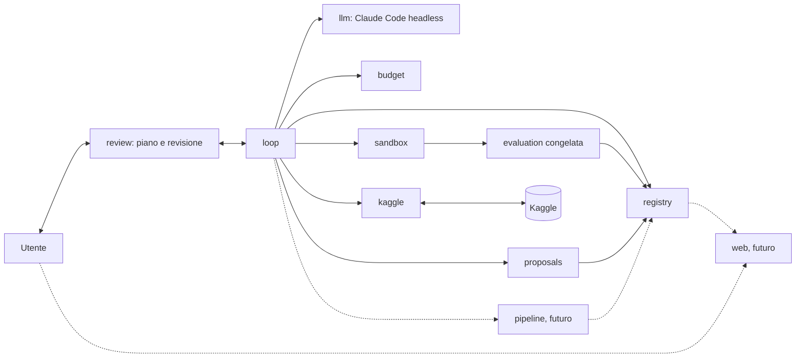

# Design dell'agente data science per Kaggle tabellare

Questo documento è il design su cui si basano tutti i ticket successivi. Non implementa l'agente. Per ogni scelta indica le alternative considerate e perché sono state scartate.

## 1. Obiettivi e non-obiettivi

**Obiettivi**

- Un agente che fa il lavoro iterativo di un data scientist su una competizione Kaggle tabellare, dal download dei dati alla submission.
- L'utente approva solo un piano iniziale breve; poi l'agente lavora in autonomia (split, baseline, iterazioni di miglioramento) e l'utente interviene solo a fine ciclo, con la revisione del report. Ogni tentativo è tracciato e consultabile da un'interfaccia web.
- Interazione con Kaggle completamente automatica: download, lettura di regole e metrica, invio delle submission, lettura del punteggio.
- Gira su un Mac senza GPU, con dataset tabellari di dimensione piccola o media.
- Nessuna API a pagamento: il modello che ragiona a runtime è Claude Code headless con la subscription.
- Metriche, schemi di validazione e tecniche non sono fissati nel design. L'agente li ricava dal problema (regole, natura dei dati, tipo di target) e li motiva. Il design definisce come li sceglie, come li giustifica e come evita di ingannare sé stesso.
- Il design non impedisce la visione futura predict + optimize (sezione 14).

**Non-obiettivi**

- Questo ticket non scrive logica di modellazione: produce il documento e uno scheletro vuoto della repo.
- Nessuna validazione dei singoli passaggi da parte dell'utente: i punti di controllo sono il piano iniziale e la revisione finale (sezione 2).
- Nessun design grafico curato dell'interfaccia: è rinviato a un ticket successivo.
- Nessun supporto a GPU, deep learning su immagini o testo, competizioni a codice (notebook-only) o dataset che non entrano in memoria su un Mac.
- Nessuna ottimizzazione per la posizione in classifica a ogni costo: l'agente non deve sacrificare la validità della valutazione per salire nel leaderboard.

**Principio sullo stack**

Python 3.12, pandas, scikit-learn, LightGBM e MLflow locale sono un **punto di partenza, non un vincolo**. Il design non li fissa. Ogni ticket di sviluppo sceglie le librerie di cui ha bisogno, valutando le alternative in quel momento e documentando la scelta. I criteri di scelta sono:

1. funziona su Mac senza GPU;
2. nessuna API o servizio a pagamento;
3. i test girano senza rete (la libreria deve poter essere simulata o usata offline);
4. costo di manutenzione basso: libreria diffusa, API stabile, poche dipendenze transitive;
5. riproducibilità: versioni bloccate e comportamento deterministico a parità di seed.

Alternativa scartata: fissare ora lo stack completo nel design. Scartata perché ancora non sappiamo cosa servirà davvero (per esempio se pandas basta o se conviene un'alternativa più veloce) e perché una scelta fatta senza codice da scrivere sarebbe senza evidenza. Per lo stesso motivo `pyproject.toml` non dichiara dipendenze di runtime.

## 2. Ciclo di lavoro

Il ciclo è una macchina a stati, implementata come codice fisso nel sottopacchetto `loop`. Lo stato è persistito dopo ogni transizione, così un crash non perde il lavoro. L'utente approva solo un piano iniziale breve; poi l'agente lavora in autonomia e l'utente interviene a fine ciclo. I singoli passaggi non sono validati dall'utente.

Stati:

| Stato | Significato | Chi agisce |
|---|---|---|
| `PLANNING` | il modello analizza problema e dati e scrive il piano iniziale breve (sezione 4) | modello |
| `AWAITING_PLAN_APPROVAL` | il piano è presentato all'utente, che lo approva o lo corregge; è l'unico punto di controllo prima del ciclo | utente |
| `SPLITTING` | il codice crea il validation set, che guida le iterazioni, e il test holdout, mai usato per decidere (sezione 5) | codice |
| `BASELINE` | primo modello addestrato e valutato sul validation | codice e modello |
| `ITERATING` | iterazione del miglioramento, con i sotto-passi `propose`, `validate`, `execute`, `analyze`, `record` | modello e codice |
| `REPORTING` | report finale breve e valutazione del test holdout sul miglior tentativo | codice e modello |
| `AWAITING_REVIEW` | l'utente accetta oppure dà suggerimenti | utente |
| `STOPPED` | un criterio di stop è scattato o il ciclo è terminato (sezione 11) | codice |

Percorso felice: `PLANNING → AWAITING_PLAN_APPROVAL → SPLITTING → BASELINE → ITERATING (N volte) → REPORTING → AWAITING_REVIEW`. Dopo l'approvazione del piano non c'è nessun altro stato di approvazione fino alla revisione finale.

**Parametri configurabili.** Il numero di iterazioni N (default 10) e il numero K di iterazioni consecutive senza miglioramento reale dopo cui il ciclo si ferma in anticipo (sezione 11).

**Una iterazione.** Il modello analizza la metrica e gli errori (sezione 9), formula un'ipotesi, decide cosa cambiare (feature engineering, modello, iperparametri, pulizia dei dati, ecc.) ed esegue un nuovo tentativo. Il codice controlla la forma del tentativo e i duplicati, esegue nella sandbox con la valutazione congelata e registra l'esito. Ogni iterazione produce un tentativo nel registro (sezione 7).

**Revisione a fine ciclo.** L'utente accetta, oppure dà suggerimenti su cosa esplorare. I suggerimenti sono registrati e avviano un nuovo ciclo, che riparte dallo stato esistente (miglior modello e storico dei tentativi) e salta la fase di approvazione del piano, salvo una modifica del protocollo (sezione 5).

Casi non felici:

- **Proposta di tentativo non valida o duplicata** (`validate`): ritorno a `propose` con il motivo del rifiuto passato al modello. Dopo un numero massimo di rifiuti consecutivi l'iterazione è registrata come `inconclusive` e il ciclo prosegue.
- **Errore di esecuzione** (eccezione, memoria, codice non valido): il tentativo è registrato come `failed` con traceback e causa e l'agente prosegue. La correzione è un nuovo tentativo registrato, senza approvazione, con un tetto di tentativi consecutivi falliti; superato il tetto il ciclo passa a `REPORTING`.
- **Timeout** di esecuzione: il processo è terminato, il tentativo è `failed(timeout)`; il tentativo successivo deve stimare un costo inferiore o ridurre i dati.
- **Timeout dell'approvazione**: vale solo per il piano e per la revisione finale. Lo stato resta in attesa; non c'è approvazione implicita. Il ciclo si sospende e può riprendere dallo stato salvato.
- **Errore del modello** (rate limit, risposta malformata): ritentativo con backoff; se persiste, il ciclo si sospende senza perdere lo stato e riprende dallo stato salvato.

Alternative scartate:

- *Convalida umana di ogni singolo passaggio*: scartata perché il requisito è che l'utente intervenga solo all'inizio e alla fine; la protezione sta nella valutazione congelata, nella sandbox e nella registrazione di tutto.
- *Approvazione separata di metrica e validazione*: scartata perché il piano breve le contiene già e un solo punto di controllo è più leggero per l'utente.
- *Nessun punto di controllo*: scartata perché una metrica o uno schema di validazione sbagliati invalidano tutto il ciclo; il piano approvato è il controllo minimo.
- *Ciclo senza tetto di iterazioni*: scartato perché consuma la quota della subscription e favorisce l'overfitting sul validation.
- *Un framework di agenti generico con grafo dinamico*: scartato perché nasconde le transizioni e rende difficile garantire che la valutazione non sia bypassata; una macchina a stati esplicita è testabile con fake.
- *Correzione automatica illimitata degli errori*: scartata perché il modello potrebbe aggirare un errore di valutazione modificando il protocollo invece del suo codice; da qui il tetto di fallimenti consecutivi.

## 3. Fasi del lavoro

Le fasi non sono una lista rigida: formano un grafo. L'agente può tornare a qualunque fase precedente quando l'evidenza lo giustifica (es. l'analisi degli errori scopre un problema di qualità dei dati). Il ritorno è deciso dall'agente senza approvazione e registrato nel tentativo con la sua motivazione. Fa eccezione il protocollo di valutazione, che è congelato (sezione 5).

| Fase | Input | Output | Cosa decide l'agente |
|---|---|---|---|
| Acquisizione | identificativo della competizione, credenziali | dati grezzi, hash dei dati, regole, descrizione della metrica | quali file scaricare; nulla di più, il resto è codice fisso |
| Comprensione del problema | regole, descrizione, dati grezzi | sintesi del problema: tipo di target, metrica ufficiale, vincoli (limiti di submission, dati esterni) | interpretazioni delle regole, riportate nel piano |
| Esplorazione dei dati | dati grezzi | profilo: tipi, valori mancanti, distribuzioni, duplicati, indizi di leakage, differenza tra train e test | analisi mirate e grafici da produrre |
| Piano iniziale | problema compreso, profilo dei dati | piano breve con metrica e perché, validazione, feature engineering, modelli, baseline (sezione 4); con l'approvazione il protocollo è congelato | il piano completo, approvato o corretto dall'utente |
| Split | piano approvato | validation set per le iterazioni e test holdout intoccato | niente: è codice fisso |
| Baseline | dati, protocollo congelato | primo modello addestrato e valutato, con la sua incertezza | la baseline semplice indicata nel piano |
| Iterazione | esiti precedenti, analisi degli errori | un tentativo con ipotesi, cambiamento e metriche | cosa cambiare: feature, modello, iperparametri, pulizia dei dati, senza approvazione |
| Analisi degli errori | predizioni fuori campione | segmenti deboli, ipotesi (sezione 9) | nuove ipotesi per le fasi precedenti |
| Combinazione | modelli candidati | ensemble o selezione | solo se i modelli hanno errori diversi, con evidenza |
| Report e pipeline | storico dei tentativi, miglior tentativo | report finale breve, test holdout, pipeline end-to-end (sezione 13), submission generata | quali tentativi raccontare e quali varianti proporre |

L'invio reale a Kaggle non è una fase del ciclo autonomo: è un'azione esplicita dell'utente dopo la revisione (sezione 10).

Alternativa scartata: pipeline lineare fissa (esplora → feature → modello → submission). Scartata perché il lavoro reale torna indietro spesso e una sequenza rigida costringe a passi inutili o a nascondere il ritorno.

## 4. Formato di una proposta

**Piano iniziale breve.** Dopo l'analisi di problema e dati l'agente scrive un piano di al massimo una pagina, leggibile in 2 minuti. È l'unico documento che l'utente approva o corregge prima del ciclo (sezione 2). Ha cinque voci obbligatorie:

1. metrica e perché;
2. schema di validazione;
3. feature engineering previsto;
4. modelli da provare;
5. baseline.

Il codice (sottopacchetto `proposals`) rifiuta i piani incompleti o troppo lunghi; il limite di lunghezza, ad esempio un numero di parole come proxy della pagina, si definisce nel ticket del modello dati. Esempio (abbreviato):

```yaml
metrica: "metrica ufficiale della competizione; è quella che decide il leaderboard"
validazione: "partizioni che imitano la separazione tra train e test (evidenza: confronto delle distribuzioni)"
feature_engineering: ["indicatori di mancanza", "codifica delle categorie rare"]
modelli: ["alberi con boosting", "modello lineare regolarizzato"]
baseline: "modello semplice con parametri di default"
```

**Tentativo.** Dopo il piano ogni iterazione è un tentativo, cioè un'ipotesi falsificabile dell'agente. Non è sottoposta all'utente: lo schema è validato dal codice e il tentativo è registrato. Campi:

- `id`, `fase`, `parent_id` (tentativo da cui discende);
- `ipotesi`: un'affermazione precisa («aggiungere X migliora Y perché Z»);
- `motivazione` con `evidenza`: in linguaggio naturale, perché è mostrata nell'interfaccia web (sezione 13); riferimenti a tentativi, grafici o analisi che la supportano; un'ipotesi senza evidenza va marcata come `esplorativa`;
- `cosa_cambia`: cosa cambia rispetto al tentativo `parent_id`;
- `effetto_atteso`: direzione e ordine di grandezza della variazione della metrica congelata;
- `misura`: come si verificherà, nel protocollo congelato, e quale esito falsifica l'ipotesi;
- `costo_stimato`: tempo di calcolo, quota di subscription;
- `rischi`: leakage, overfitting della validazione, instabilità, costo;
- `artefatti`: codice (diff), file di configurazione, pipeline collegata.

Esempio di tentativo (abbreviato):

```yaml
id: T-0014
fase: iterazione
parent_id: T-0009
ipotesi: "Gli errori sono concentrati nei record con valore mancante in 'colonna_a'; un indicatore di mancanza riduce l'errore in quel segmento."
motivazione: "Nel tentativo T-0009 l'errore è molto più alto dove 'colonna_a' manca."
evidenza: ["T-0009/error_by_segment", "profilo/missing_pattern"]
cosa_cambia: "aggiunta una feature indicatore di mancanza; modello e iperparametri invariati"
misura: "metrica congelata sul validation e sul segmento; falsificata se il miglioramento è sotto la soglia di significatività del protocollo"
```

Alternative scartate: testo libero (non verificabile dal codice, non deduplicabile), solo codice senza ipotesi (il registro non può ricordare cosa si voleva imparare) e un piano lungo e dettagliato (non si legge in 2 minuti e l'utente smette di rivederlo).

## 5. Scelta della metrica e del protocollo di valutazione

Il design non fissa metrica, schema di validazione o tecniche. Descrive il processo con cui l'agente li ricava e li giustifica.

**Derivazione.** Nella fase del piano iniziale l'agente ricava metrica e schema di validazione da tre fonti, ciascuna citata come evidenza:

1. *Regole e pagina della competizione*: la metrica ufficiale di valutazione, il formato della submission, eventuali vincoli. La metrica ufficiale è il default; se l'agente sceglie una metrica di sviluppo diversa deve spiegare perché (es. più stabile) e come si relaziona a quella ufficiale.
2. *Natura dei dati*: dipendenza temporale, gruppi o entità ripetute, distribuzione del target, dimensione. Da questi si deriva lo schema di validazione: deve imitare il modo in cui il test è separato dal train (cronologico, per gruppo, casuale). L'agente cita l'evidenza (es. confronto tra le distribuzioni di train e test, sovrapposizione degli identificativi).
3. *Tipo di target*: tipo di problema, sbilanciamento, code pesanti, che influenzano la stratificazione e la lettura della metrica.

**Giustificazione nel piano.** La giustificazione di metrica e validazione è contenuta nel piano iniziale (sezione 4), che sostituisce l'approvazione separata di metrica e validazione. Il piano dice quali metrica e schema sono scelti e perché, le alternative considerate, la soglia con cui un miglioramento è considerato reale (sezione 6) e la quota di dati tenuta come test holdout. La stima del rumore del protocollo (varianza tra seed e tra partizioni) è calcolata dal codice sulla baseline e registrata. La correlazione tra punteggio di validazione e punteggio pubblico è un controllo di coerenza fatto dopo la revisione, se l'utente invia una submission.

**Split.** Dopo l'approvazione il codice separa i dati in un validation set, che guida le iterazioni, e un test holdout, che non è mai usato per decidere ed è valutato solo alla fine del ciclo (sezione 6). Così si evita l'overfitting sul validation.

**Congelamento.** Con l'approvazione del piano il codice calcola un hash del protocollo (definizione di metrica, schema di partizione con seed, soglia, holdout, versione del codice di valutazione) e lo salva nel registro. Ogni tentativo verifica l'hash prima di partire; un hash diverso blocca il run. Il protocollo resta congelato per tutto il ciclo: una modifica in corso di ciclo non è permessa. Se l'evidenza mostra che è inadeguato, l'agente lo dice nel report finale con una proposta esplicita, motivata dall'evidenza. Se l'utente la ha approvata in revisione, vale per il ciclo successivo; i risultati precedenti sono marcati come non confrontabili e il registro conserva entrambe le versioni.

Alternative scartate:

- *Metrica e schema decisi a priori nel design (es. una scelta valida per tutte le competizioni)*: scartata perché dipende dal problema e viola il principio chiave.
- *Lasciare al modello libertà di cambiare metrica durante il ciclo*: scartata perché permette di cercare la metrica che dà il risultato migliore, cioè di ingannare sé stesso.
- *Congelare per sempre senza eccezioni*: scartata perché un errore del protocollo (es. leakage scoperto dopo) deve poter essere corretto; la via è la proposta esplicita approvata tra un ciclo e il successivo.
- *Approvazione separata di metrica e validazione prima del piano*: scartata perché il piano le contiene già con la loro giustificazione.

## 6. Miglioramento reale, rumore e overfitting

Un aumento del punteggio non è un miglioramento finché non supera le verifiche seguenti, tutte nel codice fisso di `evaluation`.

- **Rumore tra seed e partizioni.** Ogni confronto riporta la variazione tra ripetizioni (seed diversi, partizioni diverse). La baseline è misurata più volte per stimare il suo rumore. Il miglioramento è considerato reale solo se supera la soglia di significatività definita nel protocollo (sezione 5), per esempio in rapporto alla dispersione stimata; la forma esatta della soglia è decisa dall'agente per quel problema e approvata con il piano.
- **Confronti appaiati.** Due candidati sono confrontati sulle stesse partizioni, per ridurre la varianza della differenza.
- **Overfitting del validation.** Ogni tentativo adatta un po' la scelta al validation. Per questo il registro conta quanti confronti sono stati fatti e la soglia può essere alzata al crescere del loro numero. La ricerca di iperparametri avviene dentro la validazione interna, non sulla partizione di riferimento.
- **Holdout intoccato.** Il test holdout non è accessibile al modello né al codice generato e non è usato per decidere. È valutato una sola volta a fine ciclo sul miglior tentativo (ed eventualmente sulle varianti richieste dall'utente); ogni lettura è registrata e non influenza le decisioni. Se il punteggio sull'holdout è molto peggiore, il miglioramento è sospetto e il report lo dice. Con cicli ripetuti dopo i suggerimenti cresce il rischio di overfitting anche sull'holdout: il design lo registra come rischio aperto (sezione 16).
- **Stop anticipato.** K iterazioni consecutive senza miglioramento reale, cioè sopra la soglia di significatività, fermano il ciclo (sezione 11).
- **Overfitting del leaderboard pubblico.** Il punteggio pubblico riguarda una parte del test, spesso piccola. Non guida le decisioni di sviluppo: serve come controllo di coerenza con la validazione. Il numero di submission è limitato (sezione 10).
- **Diagnosi di leakage.** Un salto molto grande è trattato come sospetto e produce un tentativo di verifica prima di essere accettato.

Alternative scartate:

- *Scegliere il candidato col punteggio più alto sul leaderboard pubblico*: scartata perché con poche submission e test piccolo seleziona il rumore.
- *Un test statistico classico su una singola esecuzione*: scartato perché le partizioni non sono indipendenti e il test sovrastimerebbe la certezza; si preferisce la variazione empirica tra ripetizioni.
- *Nessuna soglia, si accetta ogni aumento*: scartata perché accumula overfitting del validation.
- *Valutare l'holdout a ogni iterazione*: scartata perché lo trasformerebbe in un secondo validation.

## 7. Registro degli esperimenti

Il registro (sottopacchetto `registry`) è la memoria dell'agente e la fonte dei dati per l'interfaccia web (sezione 13). Per ogni tentativo salva:

- ipotesi e motivazione in linguaggio naturale;
- tentativo di origine (`parent_id`) e cosa cambia rispetto a quello (`cosa_cambia`);
- configurazione completa, seed, hash del codice, hash dei dati, hash del protocollo congelato;
- metriche per partizione, media e dispersione;
- durata e risorse;
- esito: `succeeded`, `failed`, `inconclusive`, con il **motivo** (traceback, ipotesi falsificata, miglioramento sotto soglia);
- artefatti: codice e diff, predizioni, grafici, riferimento alla pipeline collegata (sezione 13);
- conclusione dell'analisi: cosa si è imparato.

**Ciclo e suggerimenti.** Un ciclo ha identificativo, piano approvato, parametri (N, K) e stato. Un suggerimento dell'utente ha testo, ciclo di origine e cicli nati da esso. Un nuovo ciclo riparte dal miglior modello e dallo storico, e il suggerimento resta registrato insieme ai cicli che ha generato.

**Query richieste.** Il registro deve supportare le query dell'interfaccia web: lista dei tentativi, serie della metrica per iterazione, dettaglio di un tentativo, suggerimenti e cicli collegati.

**Deduplicazione.** Due livelli: (1) un *fingerprint* deterministico (hash di configurazione normalizzata, dati e protocollo) scarta i duplicati esatti; (2) un controllo semantico: prima di proporre, il modello riceve un riassunto dei tentativi correlati e deve dichiarare in cosa il nuovo tentativo si differenzia. Il codice rifiuta i tentativi senza questa dichiarazione.

**Memoria dei fallimenti.** I fallimenti entrano nel contesto di `propose` come lista compatta «cosa è stato provato, esito, perché»; un tentativo fallito per un errore di codice si distingue da uno fallito perché l'ipotesi era sbagliata.

**Interfaccia sostituibile.** Il registro è dietro un'interfaccia. MLflow locale è il punto di partenza; la scelta definitiva si conferma nel ticket del registro.

Alternative considerate:

- *MLflow locale*: buona interfaccia e confronto delle run, ma dipendenza pesante e meno adatta a salvare ipotesi, cicli e suggerimenti.
- *Registro proprio (SQLite o JSONL)*: semplice, ispezionabile, nessuna dipendenza, ma serve scrivere la parte di visualizzazione.
- *Entrambi*: il proprio come fonte di verità e MLflow come vista opzionale.

Nessuna è decisa ora; si sceglie con l'evidenza nel ticket del registro. Scartata per ora: la memoria affidata solo al contesto del modello, perché si perde tra sessioni e non è verificabile.

## 8. Ruoli: modello e codice deterministico

**Il modello decide e scrive:** ipotesi, motivazioni, codice delle iterazioni (feature e modelli), interpretazione dei risultati e piano iniziale. È creativo ma non è affidabile.

**Il codice fisso (non modificabile dal modello):** ciclo e macchina a stati, split, calcolo della metrica, soglia di significatività, holdout, accesso a Kaggle e credenziali, budget, registro, hash.

**L'utente:** approva o corregge il piano iniziale e rivede il report finale (accetta o dà suggerimenti). Non convalida i singoli passaggi.

**Come si impedisce al modello di alterare la valutazione:**

1. il codice generato gira in una sandbox (sottopacchetto `sandbox`) che riceve solo i dati di addestramento e un'interfaccia stretta: una funzione che costruisce le feature e un modello; la partizione e la metrica sono eseguite fuori dalla sandbox;
2. i file di valutazione sono in sola lettura o fuori dall'albero scrivibile; il modello non ha permessi sui percorsi del codice fisso;
3. prima di ogni tentativo il codice verifica l'hash dei file di valutazione e del protocollo; una differenza blocca il run;
4. i dati del test holdout e le etichette del test non esistono nella sandbox; l'holdout è letto solo dal codice fisso a fine ciclo e ogni lettura è registrata;
5. il processo di Claude Code headless ha permessi sugli strumenti limitati allo spazio di lavoro del run; le modifiche al di fuori sono rifiutate e registrate;
6. senza un umano che rilegga i diff, il codice rifiuta automaticamente il codice che tocca file protetti e registra il diff nel tentativo, così ogni modifica è ricostruibile a posteriori.

Alternative scartate:

- *Fidarsi di istruzioni nel prompt («non modificare la valutazione»)*: scartata perché non è un controllo, solo una richiesta.
- *Lasciare scrivere al modello anche la valutazione e rivederla a mano*: scartata perché ogni modifica va riletta, non scala e un errore sottile non si vede.
- *Isolamento con container per ogni run*: rimandato; costoso su Mac. La sandbox parte da processo separato con permessi ridotti e può evolvere.

## 9. Analisi degli errori

Dopo ogni tentativo significativo il codice produce, dalle predizioni fuori campione:

- distribuzione dei residui e relazione con le feature;
- errore per sottogruppo (categorie, intervalli di valori, mancanti, periodi, gruppi);
- esempi peggiori e ambiguità delle etichette;
- confronto tra gli errori di modelli diversi (utile per la combinazione);
- scostamento tra partizioni, per rivelare instabilità.

Il codice calcola le tabelle; il modello le interpreta e le trasforma nell'ipotesi dell'iterazione successiva, nel formato della sezione 4, citando la tabella come evidenza. L'analisi non passa dall'umano ed è collegata al tentativo che l'ha prodotta, così resta consultabile. Esempi: un segmento con errore alto suggerisce nuove feature o un modello dedicato; un errore correlato al tempo suggerisce di rivedere lo schema di validazione (da segnalare come proposta esplicita nel report finale, perché il protocollo è congelato, sezione 5); etichette incoerenti suggeriscono pulizia dei dati.

Alternative scartate: lasciare al modello scegliere ogni analisi da zero (non ripetibile e non confrontabile tra esperimenti), e analisi solo globale con la metrica (nasconde dove il modello sbaglia).

## 10. Integrazione con Kaggle

L'accesso a Kaggle è codice fisso nel sottopacchetto `kaggle`, dietro un'interfaccia che i test sostituiscono con un fake.

- **Download**: il client scarica i file della competizione nella cartella `data/` (ignorata da git) e ne salva l'hash.
- **Regole e metrica**: il client scarica descrizione, pagina delle regole e della valutazione; il modello le legge e ne ricava una sintesi, che entra nel piano iniziale approvato dall'utente (sezione 4). L'accettazione delle regole, se necessaria, è un passo manuale dell'umano.
- **Submission**: la pipeline genera il file; il codice fisso valida il formato del file (colonne, righe, identificativi) prima di inviarlo, poi lo invia e legge lo stato del punteggio fino al completamento o al timeout.
- **Punteggio**: letto e registrato insieme alla submission, mai usato per cambiare il protocollo.
- **Limite giornaliero**: il codice conosce il limite e le submission rimaste. Una submission si usa solo quando vale la pena: un candidato supera la soglia di significatività sulla validazione rispetto a quello già inviato, oppure serve verificare la coerenza tra validazione e pubblico (la prima submission, un cambio di famiglia di modelli, il sospetto di leakage). Si tiene una riserva per le ultime ore. L'invio reale a Kaggle non fa parte del ciclo autonomo: la submission è generata dalla pipeline (sezione 13), ma l'invio resta un'azione esplicita dell'utente dopo la revisione e rispetta queste regole.
- **Credenziali**: vivono fuori dalla repo (`~/.kaggle/kaggle.json` con permessi `600`, oppure variabili d'ambiente) e `kaggle.json` e `.env` sono nel `.gitignore`. Solo il client Kaggle le legge; non entrano nel contesto del modello, non compaiono nei log né nel registro e non sono passate alla sandbox, che non ha rete verso Kaggle. Un controllo cerca stringhe simili a chiavi negli artefatti prima di salvarli.

Alternative scartate:

- *Il modello usa direttamente la CLI di Kaggle*: scartata perché avrebbe accesso alle credenziali e potrebbe esaurire le submission.
- *Inviare a ogni miglioramento*: scartata perché consuma il limite e spinge verso l'overfitting del leaderboard.
- *Credenziali in un file della repo cifrato*: scartata, resta il rischio di commit accidentale; meglio fuori dalla repo.

## 11. Criteri di stop e budget

Il budget è codice fisso nel sottopacchetto `budget`, configurato dall'umano all'inizio e verificato prima di ogni iterazione.

- **Iterazioni**: il numero di iterazioni del ciclo è 10 di default ed è configurabile; c'è inoltre un tetto di tentativi consecutivi falliti, distinto da N e da K.
- **Tempo**: tempo massimo totale e per singolo run.
- **Submission**: massimo totale e riserva giornaliera (sezione 10).
- **Subscription**: consumo della quota di Claude Code, misurato con il numero di chiamate e di token riportati dall'adattatore; soglia di avviso e soglia di stop. In caso di rate limit, l'agente attende secondo il backoff e sospende il ciclo senza perdere lo stato.
- **Stop anticipato per stagnazione**: se per K iterazioni consecutive non c'è miglioramento reale (sezione 6), il ciclo si ferma automaticamente e passa al report finale senza intervento dell'utente. K è configurabile.
- **Stop per obiettivo**: punteggio target dichiarato dall'umano raggiunto; il ciclo passa al report.

Alternative scartate: lasciare all'utente la decisione di fermarsi a ogni stagnazione (contraddice il lavoro autonomo), nessun limite con stop manuale (rischio di consumare la quota senza accorgersene), e un solo limite sul tempo (non protegge la subscription né le submission).

## 12. Riproducibilità

- Tutti i seed sono parte della configurazione e salvati nel registro; le partizioni sono deterministiche dal seed del protocollo.
- L'ambiente è bloccato con un lockfile; versioni di Python e delle librerie sono salvate per ogni run.
- Hash dei dati, del codice generato e del protocollo; il codice generato è salvato come artefatto, non solo come testo nel registro.
- Ogni run salva un manifest con tutto ciò che serve a rieseguirlo; un comando di replica riesegue un tentativo (anche dalla sua pipeline) e confronta il risultato con quello registrato.
- **Pipeline.** Ogni pipeline consegnata (sezione 13) ha seed fissati, dipendenze dichiarate, si lancia con un solo comando e non dipende da notebook né da stato in memoria.
- Il non-determinismo del modello (le ipotesi) non è riproducibile, ma l'intera conversazione e le decisioni sono salvate, quindi lo storico è ricostruibile.

Alternativa scartata: riprodurre rieseguendo il modello con lo stesso prompt, perché non è deterministico; si riproduce l'esecuzione, non l'ipotesi.

## 13. Interazione con l'umano

L'utente interviene in tre momenti, nel sottopacchetto `review`:

1. **Piano breve**: l'utente approva o corregge il piano iniziale (sezione 4). È l'unico punto di controllo prima del ciclo.
2. **Report finale breve**: miglior tentativo, risultato sul test holdout, cosa ha funzionato e cosa no.
3. **Revisione**: l'utente accetta, oppure dà suggerimenti su cosa esplorare. Ogni suggerimento è registrato e avvia un nuovo ciclo dallo stato esistente (sezione 7). Ogni risposta è salvata nel registro.

### Deliverable: la pipeline

L'output finale di ogni ciclo è una pipeline Python end-to-end eseguibile, oppure N pipeline se l'utente vuole tenere più varianti a confronto (ad esempio la migliore e un'alternativa più semplice). Ogni pipeline:

- copre caricamento dei dati, preprocessing, feature engineering, training, valutazione, predizione e submission;
- si lancia con un solo comando ed è riproducibile: seed fissati, dipendenze dichiarate, nessun notebook e nessuno stato in memoria (sezione 12);
- è collegata al tentativo da cui nasce: il tentativo registra il riferimento alla pipeline (sezione 7) e dall'interfaccia si passa dal tentativo alla pipeline corrispondente.

### Interfaccia web di consultazione

L'interfaccia web è consultabile senza leggere codice e legge i dati dal registro. Le viste sono:

- **lista/timeline dei tentativi**, con esito, metrica e tentativo di origine;
- **grafico della metrica per iterazione**, con il miglior tentativo evidenziato;
- **dettaglio di ogni tentativo**: ipotesi, motivazione in linguaggio naturale, cosa cambia rispetto al tentativo di origine, configurazione, metriche, durata, esito, artefatti e link alla pipeline;
- **suggerimenti dell'utente**, con i cicli nati da ciascuno.

Il design grafico curato è rinviato a un ticket successivo: in questo design contano la completezza e la navigabilità dei dati, non l'aspetto.

Alternative scartate: approvazione per lotti di proposte (contraddice il lavoro autonomo e l'utente non vede l'effetto di ciascuna), un'interfaccia web solo per l'approvazione (la tracciabilità richiede soprattutto consultazione), un report solo in Markdown (non permette di navigare tra tentativi, suggerimenti e cicli) e un grafico curato subito (rinviato).

## 14. Architettura e struttura della repo



Sottopacchetti esistenti sotto `src/kaggle_agent/`:

- `loop`: macchina a stati (sezione 2);
- `proposals`: schema e validazione di piano e tentativi (sezione 4);
- `evaluation`: metrica, split, soglia, holdout, hash (sezioni 5 e 6);
- `registry`: registro dei tentativi e deduplicazione (sezione 7);
- `kaggle`: client e fake (sezione 10);
- `llm`: adattatore di Claude Code headless, con fake;
- `sandbox`: esecuzione del codice generato (sezione 8);
- `review`: piano iniziale e revisione finale (sezione 13);
- `budget`: limiti e stop (sezione 11).

Sottopacchetti futuri, non creati in questo ticket e con nomi da confermare in revisione: `pipeline` per la generazione della pipeline end-to-end (sezione 13) e `web` per l'interfaccia di consultazione (sezione 13).

Altre cartelle: `docs/` (design), `tests/`, `data/` (ignorata da git).

**Punto di estensione per predict + optimize.** Dopo la previsione, una futura fase potrà stimare l'uplift e ottimizzare l'allocazione di un budget. Si innesta come nuovo sottopacchetto (per esempio `decision`) che consuma le previsioni registrate e come nuova fase nel grafo della sezione 3, con proprie ipotesi e un proprio protocollo congelato. Non è progettata qui; il design assicura solo che le previsioni siano salvate come artefatti e che fasi e protocolli siano estendibili.

Alternative scartate: un unico modulo monolitico (non permette di proteggere la valutazione) e un pacchetto per ogni fase del lavoro (le fasi sono dati nel grafo, non codice separato).

## 15. Piano di implementazione

Sequenza di ticket successivi. Principio: ogni ticket che introduce una dipendenza sceglie la libreria tra i propri compiti, con le alternative valutate secondo i criteri della sezione 1 (lo stack di partenza è un punto di partenza non vincolante). Tutti i test girano senza rete: Kaggle e Claude hanno un fake (simulazione) e nessun test li contatta. L'ordine mette prima ciò che protegge la valutazione e dà priorità alla tracciabilità.

1. **Modello dati di piano, tentativo e suggerimento.** Obiettivo: schema e validazione del piano breve (cinque voci, limite di lunghezza), del tentativo e del suggerimento. Criteri di accettazione: piani incompleti o troppo lunghi rifiutati; tentativi senza `cosa_cambia` rifiutati; serializzazione e rilettura identiche; esempi della sezione 4 validi.
2. **Registro dei tentativi con la tracciabilità.** Obiettivo: registro con interfaccia sostituibile (MLflow, SQLite/JSONL o altro, con le alternative), cicli e suggerimenti. Criteri di accettazione: tutti i campi della sezione 7 salvati e riletti; duplicati esatti rifiutati; fallimenti richiamabili con il motivo; query per lista, serie della metrica, dettaglio, suggerimenti e cicli collegati.
3. **Motore di valutazione con split congelato.** Obiettivo: metrica, split validation e holdout, soglia, hash. Criteri di accettazione: run bloccato se l'hash cambia; stesso seed, stesso split; holdout non accessibile al codice generato e ogni lettura registrata; soglia applicata.
4. **Client Kaggle con fake.** Obiettivo: download, regole, submission, punteggio, limite giornaliero. Criteri di accettazione: tutti i test usano il fake e nessuna rete; formato della submission validato; limite rispettato; credenziali assenti dai log.
5. **Adattatore Claude headless con fake.** Obiettivo: chiamare Claude Code in modo non interattivo e leggerne l'esito. Criteri di accettazione: fake che simula risposte, risposte malformate e rate limit; consumo registrato; nessun test chiama Claude e nessuna rete.
6. **Sandbox di esecuzione.** Obiettivo: eseguire il codice generato con permessi ridotti. Criteri di accettazione: timeout applicato; scrittura sui file protetti impossibile e diff che li tocca rifiutato; nessun accesso a credenziali e holdout.
7. **Macchina a stati del ciclo autonomo.** Obiettivo: piano, baseline, N iterazioni, stop anticipato e ripresa. Criteri di accettazione: percorso felice con fake di modello e utente; default di 10 iterazioni configurabile; stop dopo K iterazioni senza miglioramento; errori registrati come `failed` con tetto di fallimenti; ripresa dallo stato salvato.
8. **Generatore di pipeline end-to-end collegata al tentativo.** Obiettivo: produrre la pipeline eseguibile (e N varianti su richiesta). Criteri di accettazione: un solo comando; seed e dipendenze dichiarati; nessun notebook; riferimento registrato nel tentativo; replica che riproduce la metrica.
9. **Budget e stop.** Obiettivo: limiti e criteri di stop. Criteri di accettazione: ogni limite blocca il ciclo; stagnazione rilevata; rate limit gestito con attesa simulata.
10. **Report finale e revisione con suggerimenti e nuovi cicli.** Obiettivo: report breve, valutazione dell'holdout, accettazione o suggerimenti. Criteri di accettazione: il report contiene miglior tentativo, risultato sul test holdout, cosa ha funzionato e cosa no; un suggerimento è registrato e avvia un ciclo dal miglior modello e dallo storico.
11. **Interfaccia web di consultazione.** Obiettivo: viste di lista/timeline, grafico della metrica, dettaglio e suggerimenti. Criteri di accettazione: le quattro viste mostrano i dati del registro; il dettaglio mostra la motivazione e il link alla pipeline; test senza rete.
12. **Orchestratore e prima competizione end-to-end.** Obiettivo: collegare i componenti e completare una competizione tabellare scelta dall'utente, con fake nei test e Kaggle reale a mano. Criteri di accettazione: ciclo completo con i fake; una submission reale inviata dall'utente dopo la revisione; registro e pipeline riproducibili.

Un ticket successivo, fuori da questo piano, riguarda il design grafico curato dell'interfaccia.

Alternativa scartata: un solo grande ticket di implementazione, perché non è revisionabile.

## 16. Rischi aperti e domande per l'umano

**Rischi aperti**

- Il comportamento di Claude Code headless con la subscription (limiti, rate limit, permessi sugli strumenti, cicli lunghi e autonomi) non è verificabile in questo ambiente senza rete; va confermato nel ticket dell'adattatore.
- Divergenza di un ciclo autonomo: senza controlli intermedi il ciclo può percorrere direzioni inutili; mitigazioni sono il tetto di iterazioni, lo stop anticipato, il tetto di fallimenti consecutivi e la tracciabilità.
- Overfitting sull'holdout: l'holdout è letto a fine di ogni ciclo, quindi con cicli ripetuti cresce. Il design registra ogni lettura ma non lo risolve (per esempio con un nuovo holdout): punto aperto.
- Qualità del piano breve: un piano povero o sbagliato, approvato in fretta, condiziona tutto il ciclo.
- Costo in quota della subscription per ciclo autonomo, sconosciuto.
- Le regole di alcune competizioni vietano dati esterni o limitano l'automazione; la lettura delle regole fatta dal modello può sbagliare, per questo entra nel piano che l'utente approva.
- La sandbox su Mac senza container offre un isolamento parziale.
- Il leaderboard pubblico può essere poco informativo; il protocollo cerca di non dipenderne.
- Il test del documento controlla struttura e parole chiave, non la qualità: la revisione umana resta necessaria.

**Librerie del punto di partenza ancora da confermare:** pandas, scikit-learn, LightGBM e MLflow. Ognuna sarà confermata o sostituita nel ticket che la usa.

**Domande per l'umano**

1. Quale competizione è la prima da affrontare end-to-end?
2. Quanta quota di subscription è accettabile per competizione?
3. Quante submission al giorno si è disposti a usare, e quale riserva tenere?
4. Va bene un'interfaccia web per la consultazione dei tentativi, con l'approvazione del piano e la revisione fuori dal web?
5. Va bene che gli errori di esecuzione siano corretti in automatico con un tetto di tentativi consecutivi falliti, e quale tetto?
6. Sono ammessi dati esterni o modelli pre-addestrati quando la competizione li consente?
7. Quali valori di default per il numero di iterazioni N (ora 10) e per K dello stop anticipato?
8. Si vogliono più pipeline per ciclo e quali varianti tenere (ad esempio la migliore e una più semplice)?
9. L'invio a Kaggle va fatto dopo la revisione, come azione esplicita dell'utente?
